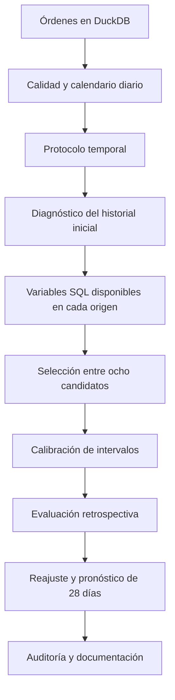

# Guía completa: comprender y resolver el pronóstico de pedidos de Olist

Esta guía explica el problema, el desarrollo y la interpretación de la solución. Puedes leerla sin ejecutar código. Los tres notebooks contienen las operaciones, tablas y gráficos comentados; esta guía conecta sus piezas y explica por qué son necesarias.

El alcance es **Módulo 0: calidad y exploración de datos; Módulo B: series de tiempo**. Los módulos de clasificación, segmentación e integración y la extensión opcional por categorías/estados no forman parte de esta entrega.

## 1. El problema que queremos resolver

Imagina que al terminar un martes debes organizar el trabajo de las cuatro semanas siguientes. Conoces las compras registradas hasta ese martes, pero todavía no sabes cuántas llegarán mañana. Necesitas una estimación para cada día y una idea del margen de incertidumbre.

La pregunta es: **al cierre de una fecha, ¿cuántas órdenes de compra recibirá Olist cada uno de los próximos 28 días?** Una estimación así puede apoyar planificación de personal, atención o capacidad; no calcula directamente inventario por producto, ingresos ni entregas.

La variable objetivo se llama `y`: número de órdenes distintas registradas en un día. Cada orden cuenta una vez aunque tenga varios artículos. Su fecha es la de compra, `order_purchase_timestamp`. Se incluyen todos los estados finales porque el objetivo es demanda recibida.

Una serie de tiempo es una sucesión de observaciones ordenadas por fecha. Aquí tiene frecuencia diaria. La predicción se expresa como `y_hat(o,h)`: estimación emitida al cierre del origen `o` para el día `o+h`. El horizonte `h` puede valer de 1 a 28.

No existe una estimación infalible. Buscamos un procedimiento que aprenda del pasado, sea comparable con reglas simples y describa honestamente sus errores.

## 2. Cómo recorrer la entrega

1. [00_datos_y_calidad.ipynb](../notebooks/00_datos_y_calidad.ipynb): qué significa cada tabla, calidad, cobertura y serie diaria.
2. [01_exploracion_temporal.ipynb](../notebooks/01_exploracion_temporal.ipynb): separación temporal, tendencia, patrón semanal, STL, ACF/PACF y estacionariedad.
3. [02_modelado_y_pronostico.ipynb](../notebooks/02_modelado_y_pronostico.ipynb): variables, ocho candidatos, selección, intervalos, prueba y pronóstico.
4. [informe.md](informe.md) y [informe.pdf](informe.pdf): resultados consolidados de la ejecución.
5. [auditoria.md](auditoria.md): comprobaciones independientes.

Las tablas numéricas están en `resultados/`. Las consultas están en `sql/`. Las funciones compartidas están en `src/`, con comentarios y documentación. Un notebook puede usar esas funciones sin ocultar la metodología: el código fuente acompaña la entrega.

## 3. Primero entender los datos

### 3.1. Granularidad: una fila no siempre equivale a una compra

`orders` contiene una fila por orden. `order_items` contiene artículos y `order_payments`, registros de pago. Una orden con tres artículos y dos pagos puede generar seis filas si unimos ambas relaciones sin agregarlas primero.

Por eso contar filas después de esa unión exageraría la demanda. La serie se construye directamente desde `orders`. Para conciliar pagos, primero sumamos artículos por orden y pagos por orden por separado; después unimos ambos resultados.

`customer_id` identifica el registro de cliente de una compra; `customer_unique_id` permite reconocer al mismo comprador en varias compras. Confundirlos lleva a subestimar recurrencia. Los prefijos de geolocalización se repiten por diseño: no son una llave de fila única.

### 3.2. Qué problemas revisamos y qué hacemos con ellos

Se comprueban llaves, nulos, fechas, ítems huérfanos, categorías, geolocalización y diferencias entre pagos y artículos. Una orden sin entrega puede estar cancelada; ese dato faltante no equivale automáticamente a un error. Una discrepancia monetaria merece investigación, pero no implica que la compra no ocurrió.

Para este objetivo importan especialmente la identidad de la orden y su fecha de compra. Los problemas ajenos al conteo se documentan sin borrar compras arbitrariamente. También conservamos picos de demanda: una observación extrema puede ser un hecho comercial real.

### 3.3. Qué aporta la exploración común

Las tablas de clientes, estados y entregas describen el negocio. Las distribuciones de entrega se calculan sobre registros con las fechas necesarias, por lo que no representan a las órdenes todavía sin entregar. El retraso se mide en días calendario respecto a la fecha estimada.

Estas variables finales de entrega no entran al pronóstico de compras. Usar información que solo se conoce después de una compra puede producir fuga si se presenta como disponible antes.

## 4. Construir una serie diaria confiable

### 4.1. Elegir un período útil

Utilizamos **1 de febrero de 2017 a 21 de agosto de 2018**. Hay actividad inicial escasa y un descenso de registros en el extremo final seguido de observaciones aisladas. El corte delimita un tramo de actividad continua.

No podemos demostrar con estas tablas la causa del descenso final. Por tanto, el corte es una decisión analítica de cobertura y las conclusiones son condicionales a ella. Otra delimitación razonable podría producir métricas distintas. No se optimizó la fecha para obtener un resultado favorable.

La auditoría de cobertura necesita observar los extremos de la base; el diagnóstico que orienta los modelos se limita después al historial anterior a la primera validación. Esta distinción no convierte la evaluación en ciega: el conjunto histórico ya ha sido examinado.

### 4.2. Completar el calendario con SQL

La consulta genera cada fecha entre los límites, cuenta órdenes por fecha y une los conteos al calendario. Si dentro del período una fecha no tiene compras, se asigna cero. Fuera del período no se interpreta automáticamente una ausencia de registros como demanda nula.

Esto garantiza que siete filas representen siete días. Sin calendario completo, `lag(7)` podría saltar más de una semana. Se verifica que no haya fechas repetidas, saltos ni conteos negativos.

El resultado contiene **567 días y 97.590 compras**. Dentro de ese tramo no aparecen días de demanda cero, pero la construcción sigue preparada para representarlos correctamente.

## 5. Por qué separamos el tiempo antes de modelar

En problemas tabulares a veces se reparten filas al azar. En pronóstico, hacerlo puede permitir que el entrenamiento vea acontecimientos posteriores al ejemplo evaluado. El modelo parecería conocer el futuro.

El procedimiento es **walk-forward con ventana expansiva**: entrenar con el pasado, predecir 28 días, avanzar siete días y entrenar otra vez con la historia disponible. El pasado permitido crece con cada emisión.

| Etapa | Orígenes de emisión | Fechas objetivo evaluadas | Emisiones | Función |
|---|---|---|---:|---|
| Selección | 2017-07-25 a 2018-02-13 | 2017-07-26 a 2018-03-13 | 30 | Comparar candidatos y elegir uno |
| Calibración | 2018-03-13 a 2018-05-29 | 2018-03-14 a 2018-06-26 | 12 | Estimar márgenes del elegido |
| Prueba | 2018-06-26 a 2018-07-24 | 2018-06-27 a 2018-08-21 | 5 | Evaluar el procedimiento posterior |

Los orígenes están separados siete días dentro de cada etapa. El último horizonte de selección termina antes del primer objetivo de calibración; lo mismo ocurre entre calibración y prueba. Los espacios entre listas de orígenes evitan que sus objetivos se crucen; no se pierde historia para entrenar.

En prueba hay **140 pares origen-horizonte por modelo y 56 fechas distintas**. Una fecha central puede recibir cuatro predicciones emitidas con anticipaciones diferentes. Eso reproduce decisiones operativas distintas, pero genera dependencia y peso desigual por fecha.

La métrica principal da igual peso a cada par. También se informa una alternativa que primero promedia errores por fecha y luego entre fechas. No se promedian predicciones para crear un ensamble: se promedian sus pérdidas.

En una emisión posterior de prueba se pueden usar las compras de prueba que ya ocurrieron antes de ese origen. Es un reajuste operativo válido. Lo que se mantiene fijado es el candidato seleccionado y la calibración de incertidumbre.

**Límite central:** las fechas de prueba ya eran conocidas en el contexto del ejercicio. Estos resultados son retrospectivos, aunque el código respete el orden temporal. Para una evaluación nueva e independiente harían falta datos posteriores no utilizados en decisiones.

## 6. Aprender a leer los patrones temporales

El diagnóstico inicial usa **175 días, hasta el 25 de julio de 2017**. No se usan datos de prueba para justificar órdenes o transformaciones.

### 6.1. Nivel, tendencia y estacionalidad

El nivel es la cantidad habitual de pedidos. La tendencia describe una evolución lenta. La estacionalidad es un patrón que se repite con un período: aquí interesa la semana de siete días.

Una media móvil de siete días resume una semana; una de 28 suaviza más. Ambas terminan en el origen cuando se usan para modelar. Una ventana centrada usaría datos posteriores y no sería admisible como característica disponible en ese momento.

La tabla por día semanal presenta medias y medianas. La media es sensible a picos; la mediana describe el centro ordenado. Una diferencia entre lunes y domingos es descriptiva, no una demostración causal de que el nombre del día produzca una cantidad determinada.

### 6.2. STL

STL separa aproximadamente `observación = tendencia + estacionalidad + residuo`. Usamos período 7 y ajuste robusto para reducir la influencia de observaciones extremas en los componentes.

El residuo STL es lo que esa descomposición no explica. No es el error de un pronóstico emitido en el pasado. STL puede usar vecinos posteriores dentro del tramo analizado; sus componentes se muestran para interpretar y no se introducen en los modelos.

### 6.3. ACF y PACF

La ACF mide asociación con rezagos; la PACF estima la asociación adicional de un rezago después de controlar los intermedios. Picos cerca de 7, 14 o 21 días pueden orientar hacia un patrón semanal.

Una tendencia también puede elevar la autocorrelación. Estos gráficos no permiten leer automáticamente el modelo perfecto y deben interpretarse junto con la serie, las pruebas y la evaluación temporal.

### 6.4. Estacionariedad, ADF y KPSS

Una serie estacionaria mantiene ciertas propiedades estadísticas aproximadamente estables en el tiempo. Muchos modelos ARIMA buscan una representación más estable mediante diferencias.

- Primera diferencia: `y(t)-y(t-1)`.
- Diferencia semanal: `y(t)-y(t-7)`.
- ADF tiene como hipótesis nula una raíz unitaria. Un p pequeño aporta evidencia contra esa hipótesis.
- KPSS tiene como hipótesis nula estacionariedad alrededor de un nivel. Un p pequeño aporta evidencia contra ella.

Las hipótesis son distintas: dos pruebas pueden dar resultados que requieren una lectura matizada. No rechazar una hipótesis tampoco la demuestra. KPSS usa una tabla limitada; por eso se presentan límites como `<=0,01` o `>=0,10` en vez de fingir una precisión inexistente.

En el tramo inicial, el nivel no supera ambas comprobaciones de estabilidad. La diferencia semanal presenta evidencia más compatible con estabilidad en esas especificaciones. Eso no obliga a aplicar diferencia semanal en todos los candidatos: ETS representa directamente nivel y tendencia, y SARIMAX puede representar la semana mediante regresores.

## 7. Convertir el pasado en variables para Machine Learning

### 7.1. El ejemplo de entrenamiento

Cada fila representa un par `(origen, horizonte)`. Sus entradas describen la historia conocida al cierre del origen y el calendario del objetivo. La salida es la cantidad de compras en `origen+h`.

Es un modelo **directo global**: un único LightGBM aprende todos los horizontes usando `h` como variable. No se entrena un modelo separado por horizonte y no se alimentan predicciones intermedias de forma recursiva.

Los pares reutilizan fechas reales. Tener miles de pares no significa haber observado miles de días independientes. Los primeros 90 días permiten disponer de ventanas de 91 días; la comparación ML utiliza las mismas filas para las cuatro variantes.

### 7.2. Variables básicas y ampliadas

| Grupo | Variables | Interpretación |
|---|---|---|
| Nivel reciente | `lag_0`, `lag_6`, `lag_13`, `lag_27` | Compras del origen y de fechas pasadas precisas |
| Ventanas básicas | `media_7`, `media_28`, `sd_28` | Nivel medio reciente y dispersión de 28 días |
| Calendario | `h`, día de semana/mes, mes, tendencia, festivo, Black Friday, pos-Black Friday, fin de año | Anticipación y fechas conocidas |
| Última semana completa | `lag_1` a `lag_5`, junto a `lag_0` y `lag_6` | Trayectoria reciente diaria |
| Referencia larga | `media_91` | Nivel de aproximadamente trece semanas |
| Relaciones | `media_7/(1+media_28)`, `media_28/(1+media_91)` | Diferencias entre niveles recientes y largos |
| Variabilidad escalada | `sd_28/(1+media_28)` | Dispersión relativa al nivel; versión estabilizada, no CV clásico exacto |
| Día comparable | `ultimo_mismo_dia`, `media_4_mismo_dia` | Última observación y promedio de cuatro del mismo día semanal del objetivo |
| Rezagos relativos | `log(1+valor)-log(1+media_28)` | Magnitud de rezagos/días comparables respecto al nivel reciente |

El `+1` permite operar con ceros y estabilizar denominadores. Por eso las razones no deben interpretarse como porcentajes exactos de crecimiento, especialmente cuando hay pocos pedidos.

El día comparable depende del objetivo. Al cierre de un martes, para predecir el miércoles usamos el miércoles anterior; para predecir el martes siguiente podemos usar el martes del origen. Todo se calcula con SQL antes de que exista la etiqueta futura.

### 7.3. La regla más importante contra la fuga

En un ajuste de fecha `o`, una fila solo puede entrenar si **su fecha objetivo es menor o igual a `o`**. Exigir solo que el origen de esa fila sea anterior no basta: una fila emitida ayer a 28 días todavía apunta a una etiqueta desconocida.

El campo `real` es etiqueta, nunca variable predictora. Las características se calculan con ventanas que terminan en el origen. Las fechas futuras y los festivos conocidos pueden utilizarse; las compras futuras no.

La auditoría retira físicamente de la consulta todas las compras posteriores a dos orígenes y reproduce las predicciones de los ocho modelos. Es una comprobación efectiva de causalidad temporal en esos casos.

## 8. Los ocho candidatos y por qué compararlos

### 8.1. Ingenuo

Repite el último valor observado. Si el martes hubo 150 pedidos, pronostica 150 para los 28 días. Es fácil de explicar, pero ignora la semana y la tendencia.

### 8.2. Estacional de siete días

Repite los últimos siete valores cuatro veces. Si los domingos suelen ser distintos de los lunes, conserva esa diferencia. Es una referencia exigente para un negocio con patrón semanal.

Un modelo complejo que no mejora esta referencia merece revisión antes de utilizarse operativamente. Que un baseline gane en prueba es información útil, no un motivo para ocultarlo.

### 8.3. ETS con tendencia amortiguada

ETS representa nivel, tendencia y estacionalidad semanal aditiva. La amortiguación reduce la extrapolación indefinida de la tendencia: el crecimiento reciente no continúa necesariamente con la misma pendiente durante todo el horizonte.

Se ajusta de nuevo en cada origen. No usa los indicadores de calendario de los otros candidatos, lo cual forma parte de su capacidad y limitación.

### 8.4. SARIMAX con calendario

Se modela `log(1+y)` con errores ARIMA(1,1,1) y regresores conocidos. `p=1` representa un término autorregresivo; `d=1`, una primera diferencia; `q=1`, un término de media móvil de innovaciones. La X representa variables externas.

La semana se representa mediante seis indicadores de día, con domingo como referencia. La especificación no tiene un componente ARIMA estacional adicional. El nombre SARIMAX corresponde a la familia implementada por statsmodels; no implica que todo componente posible esté activado.

Se incluyen festivos nacionales, Black Friday, cuatro días posteriores y fin de año cuando esas variables ya tienen variación en el historial. Si todavía no ocurrió un evento, no puede estimarse su coeficiente. Se evita así simular que conocemos su magnitud por tener una columna de calendario.

Se revisa convergencia en cada ajuste y se registra Ljung–Box en residuos. El AIC de SARIMAX en logaritmos no se compara directamente con el AIC de ETS en pedidos. La elección final usa errores predictivos en la misma escala de pedidos.

Invertir la media del pronóstico logarítmico mediante `expm1` no devuelve automáticamente la media de pedidos: bajo una distribución lognormal se relaciona con su mediana. No se aplica una corrección de media sin justificar su objetivo y supuestos.

### 8.5. Cuatro LightGBM y una comparación controlada

LightGBM combina árboles de decisión. Un árbol puede distinguir, por ejemplo, domingos de lunes o historiales con diferente nivel. El conjunto aprende relaciones que no tienen que ser lineales.

Los árboles no extrapolan automáticamente una tendencia lineal fuera del rango que observaron; dependen de las variables y patrones aprendidos. La referencia relativa intenta representar el nivel reciente de otra manera, pero su beneficio se verifica empíricamente.

Se fijan 300 árboles, 7 hojas, tasa 0,03, mínimo de 40 muestras por hoja, regularización L2 y pérdida L1. Las cuatro variantes usan la misma semilla y la misma muestra:

| Variante | Variables | Objetivo |
|---|---|---|
| `LGBM_base_absoluto` | Básicas | Pedidos |
| `LGBM_amplio_absoluto` | Ampliadas | Pedidos |
| `LGBM_base_relativo` | Básicas | Diferencia logarítmica respecto a media de 28 días |
| `LGBM_amplio_relativo` | Ampliadas | Diferencia logarítmica respecto a media de 28 días |

Esta comparación permite aislar el conjunto de variables y la formulación del objetivo, manteniendo los demás elementos. No atribuye el resultado a una sola variable dentro del conjunto ampliado ni demuestra que esos hiperparámetros sean óptimos para cada variante.

## 9. Entender el objetivo relativo

La transformación es:

`r = log(1+y_futuro) - log(1+media_28_origen)`.

La inversión es:

`predicción = exp(r_predicho) × (1+media_28_origen) - 1`.

Si la media reciente es 200 y el valor futuro es 220, `r` es aproximadamente 0,095. Al invertir se recuperan 220 pedidos. La referencia es siempre la media disponible al origen, nunca una media calculada durante los días futuros.

La idea es aprender variaciones relativas que puedan transferirse entre períodos con distintos niveles. Pero la pérdida absoluta sobre logaritmos no pondera igual que la pérdida absoluta sobre pedidos: un error de 20 pedidos tiene diferente importancia relativa cuando se venden 40 que cuando se venden 400.

Por eso se evalúa el resultado final en pedidos. No se presupone que transformar sea mejor. Además, `expm1` puede dar valores negativos; el código aplica explícitamente un mínimo de cero.

L1 busca una mediana condicional en el problema ideal, con aproximaciones por capacidad del modelo y muestra. La suma de medianas diarias no es, en general, la mediana del total. Tampoco es automáticamente su media esperada.

## 10. Qué miden MAE, RMSE, sMAPE y sesgo

- **MAE:** promedio de `|real-pred|`. MAE=40 significa error absoluto promedio de 40 pedidos por par evaluado; no significa error máximo de 40.
- **RMSE:** raíz del promedio de `(real-pred)^2`. Penaliza con mayor fuerza los errores grandes y permanece en pedidos.
- **sMAPE:** promedio de `200×|real-pred|/(|real|+|pred|)`. Aquí se define cero cuando ambos valores son cero. Puede alcanzar 200 %.
- **Sesgo:** promedio de `pred-real`. Positivo indica sobrepronóstico; negativo, subpronóstico.

Ejemplo: reales `[100,200]` y predicciones `[90,230]` producen errores absolutos `[10,30]`: MAE=20 y RMSE≈22,36. El sesgo es 10, pero ese promedio firmado oculta que hubo un error hacia abajo y otro hacia arriba.

Se informa globalmente, por origen, por horizonte y por semana de horizonte. Cada lectura responde una pregunta: rendimiento promedio, estabilidad entre épocas, efecto de anticipación y planificación semanal.

Una curva de error no tiene que crecer continuamente con el horizonte. Hay pocas emisiones y diferentes fechas evaluadas. Tampoco se calcula una prueba de significancia que trate los orígenes solapados como independientes.

## 11. Cómo se elige el modelo

Se ajustan los ocho candidatos en los 30 orígenes de selección y se calcula MAE sobre sus 840 pares por modelo. Todos tienen el mismo número de objetivos por emisión; por eso promediar los errores de todos los pares equivale a promediar los MAE de los orígenes.

El menor MAE determina la elección; ante un empate exacto se usa el nombre en orden alfabético para que el procedimiento sea determinista. RMSE y sMAPE complementan la interpretación. No se cambia de candidato después de consultar la clasificación de prueba.

Las diferencias por origen permiten ver cuántos períodos favorecen cada formulación. Una mejora pequeña del promedio puede venir de pocos episodios y no justificar una conclusión de superioridad general.

## 12. Incertidumbre diaria: puntos y rangos tienen funciones distintas

El punto representa una estimación central. El intervalo describe un margen construido a partir de errores históricos. Necesitamos ambos para planificar: un punto de 200 con rango muy estrecho representa una situación distinta del mismo punto con rango de 30 a 500.

El modelo seleccionado se ajusta en 12 orígenes de calibración. Esas fechas no participaron en su selección. Se guardan errores por semana del horizonte: h1–7, h8–14, h15–21, h22–28.

Se definen dos métodos:

1. **Absoluto:** residuo `|real-pred|`; margen `q` pedidos.
2. **Relativo:** residuo `|real-pred|/(1+pred)`; margen `q×(1+pred)` pedidos.

El relativo es el método principal fijado antes de la prueba. El absoluto se presenta para análisis paralelo. No se escoge el que resulte más atractivo después de ver la cobertura de prueba.

Para un nivel nominal de 90 %, se ordenan los residuos y se toma el de rango `ceil((n+1)×0,90)`. Hay 84 residuos diarios por grupo: rango 77. Es un elemento de la lista ordenada, sin interpolación. Si el rango excede la muestra disponible, el código detiene el cálculo en vez de fingir una garantía finita.

Los límites son `max(0,pred-margen)` y `pred+margen`. La cobertura empírica cuenta cuántos reales quedaron dentro; la amplitud mide cuán ancho fue el intervalo. Ambos indicadores importan.

Estos intervalos se inspiran en calibración conformal, pero aquí los residuos dependen del tiempo, se solapan y proceden de modelos reajustados. La corrección de rango no basta para afirmar una garantía exacta. El 90 % es nominal, no una probabilidad individual demostrada para cada día.

## 13. Incertidumbre de totales semanales

Una semana operativa va de miércoles a martes. Para cada emisión sumamos los siete reales y los siete puntos; el residuo semanal es la diferencia absoluta entre esos totales, o su versión relativa.

Los cuantiles se estiman **sobre esos residuos de totales**. Hay 12 por posición semanal y el rango al 90 % es 12: el máximo observado. Esto puede dar intervalos amplios o sensibles a un solo episodio. Se informa para hacer visible esa limitación.

Sumar límites diarios no conserva automáticamente la cobertura. Un ejemplo extremo ayuda: cada variable diaria vale 0 con probabilidad 0,8 y 1 con probabilidad 0,2, de forma independiente. El intervalo diario `[0,0]` cubre 80 %. La suma de esos límites es `[0,0]`, pero cubrir el total de siete días requiere siete ceros: `0,8^7≈21 %`, no 80 %.

Los intervalos de cada total semanal tampoco son una garantía conjunta de que las cuatro semanas queden cubiertas ni se suman para anunciar un intervalo mensual de 90 %.

## 14. Eventos extraordinarios: conservar y contextualizar

Black Friday 2017 permanece en la serie. Antes de ese evento, los modelos no tienen otro Black Friday en el tramo útil del que aprender su magnitud. La columna de calendario indica la fecha, pero no aporta mágicamente su efecto.

La huelga de mayo de 2018 se conserva en calibración. Puede elevar los errores y los márgenes. No se entrega un indicador de huelga futura porque no se presume que el evento fuera conocido con 28 días de anticipación.

Comparar el promedio de esos días con el resto describe el conjunto. No demuestra causalidad: crecimiento, calendario, campañas y otras circunstancias difieren entre períodos. La entrega distingue explícitamente entre observación e hipótesis explicativa.

## 15. Emitir y leer el pronóstico final

Después de evaluar, se reajusta el candidato seleccionado hasta el 21 de agosto de 2018 y se generan 28 puntos para el 22 de agosto al 18 de septiembre de 2018. Los reales futuros permanecen vacíos en los archivos.

Esto es una simulación histórica, no un pronóstico para la actualidad. Los cuantiles se conservan desde calibración; no se usa la prueba para escoger nuevos márgenes. No hay evidencia observada de cobertura para esos 28 días finales dentro del período útil seleccionado.

Los CSV conservan decimales. La presentación puede redondearlos, pero conviene sumar primero y redondear después. La suma se denomina **suma de pronósticos puntuales**. No se afirma que sea automáticamente la media esperada ni la mediana de la demanda total.

En `pronostico_semanal.csv` cada fila tiene su total puntual y un intervalo calibrado directamente para ese total. No se obtiene sumando los límites de `pronostico_diario_28_dias.csv`.

## 16. Cómo interpretar la importancia de variables

Se muestra la importancia por ganancia del mejor candidato ML según selección. Resume cuánto ayudaron las divisiones de árboles a reducir su función de pérdida durante el ajuste.

Una variable importante no implica un efecto causal. Variables correlacionadas pueden repartirse importancia, y una importancia pequeña no demuestra irrelevancia universal. La gráfica sirve para entender el comportamiento del modelo, no para elegirlo retroactivamente usando la prueba.

## 17. Qué verifica la auditoría

La auditoría comprueba conteos y continuidad, fronteras temporales, fechas objetivo, reales, baselines, métricas SQL, ventanas de características, cuantiles exactos, sumas, límites, cobertura y ejecución de notebooks.

También reconstruye la serie hasta dos cortes y reproduce las predicciones de los ocho modelos sin tener compras futuras disponibles. Finalmente reproduce el ajuste final y confirma que los totales semanales coincidan con la suma de puntos diarios.

Los resultados de estas pruebas respaldan la consistencia de la ejecución; no demuestran que el modelo sea óptimo ni que mantenga rendimiento futuro. Se conservan versiones de paquetes, huellas de CSV y configuración para facilitar reproducción.

## 18. Preguntas para comprobar tu comprensión

**¿Por qué una orden de tres artículos cuenta una vez?** Porque el objetivo es número de órdenes, no artículos vendidos.

**¿Por qué conocer el martes futuro no es fuga?** Porque el calendario se sabe al emitir. El número de compras de ese martes todavía no se sabe.

**¿Por qué no basta con filtrar el origen de una fila ML?** Porque su etiqueta puede apuntar a una fecha posterior al ajuste.

**¿Por qué un modelo con menor error de entrenamiento puede ser peor?** Porque puede ajustar particularidades del historial que no se repiten. La comparación relevante usa objetivos posteriores al origen.

**¿Por qué conservar una referencia simple?** Porque cuantifica si la complejidad añade utilidad real frente a una regla interpretable.

**¿Por qué 140 predicciones no son 140 días independientes?** Porque corresponden a 56 fechas, algunas pronosticadas desde varios orígenes, además de la dependencia temporal habitual.

**¿Una cobertura mayor siempre es mejor?** Solo si se considera también la amplitud y utilidad del rango. Un intervalo enorme puede cubrir casi todo y servir poco para planificar.

**¿Qué haría falta para usarlo en producción?** Datos recientes, revisión del período operativo, evaluación posterior no utilizada para diseñar, actualización periódica, vigilancia de sesgo/cobertura y una política de actuación frente a errores. Este ejercicio no aporta por sí solo esa validación.

## 19. Referencias y reproducción

Datos: [Brazilian E-Commerce Public Dataset by Olist](https://www.kaggle.com/datasets/olistbr/brazilian-ecommerce). La base se construye con el script suministrado en el curso, conservado en `scripts/build_olist_duckdb.py`.

Lecturas: [Forecasting: Principles and Practice](https://otexts.com/fpp3/), [statsmodels](https://www.statsmodels.org/), [LightGBM](https://lightgbm.readthedocs.io/) y [holidays](https://holidays.readthedocs.io/).

El [README](../README.md) contiene comandos de instalación, ejecución y auditoría. Los notebooks incluyen sus resultados para poder leerse sin descargar datos ni instalar Python. La base DuckDB se excluye del repositorio y del ZIP.

## 20. Lectura detallada de los resultados de esta ejecución

Esta sección interpreta cifras producidas por los notebooks. Las tablas completas permiten comprobar cada afirmación.

### 20.1. Calidad y contexto

La base contiene 99.441 órdenes. En las comprobaciones aparecen 775 sin ítems, una sin pagos y 280 discrepancias mayores a dos centavos entre los totales comparados. No hay órdenes duplicadas por su llave ni compras sin fecha en la auditoría realizada. El cruce directo con ítems y pagos produce 118.434 filas: confirma por qué no sirve como unidad de conteo.

Se registran 160 aprobaciones y 2.965 entregas ausentes; 610 productos sin categoría y 13 productos cuya categoría carece de traducción. Esos problemas se informan, pero no se usan para eliminar compras válidas de la serie. Los resultados detallados están en las tablas de calidad.

En las 96,470 entregas incluidas por la consulta, la mediana es 10 días y el percentil 90 es 23; la proporción tardía es 6.77%. Esto describe entregas observadas, no las que faltan.

Hay 2,997 compradores con más de una compra entre 96,096 identificadores únicos, aproximadamente 3.12%. São Paulo reúne 41,746 registros de cliente asociados a compras; no deben confundirse con compradores únicos. Estas cifras contextualizan el conjunto y no son entradas futuras del modelo.

### 20.2. Diagnóstico inicial

| serie | ADF_p | KPSS_limite | ADF_lectura | KPSS_lectura |
| --- | --- | --- | --- | --- |
| nivel | 0.710938 | <= 0.01 | No rechaza raíz unitaria | Rechaza estacionariedad |
| diferencia_1 | 4.71204e-06 | 0.0417 | Rechaza raíz unitaria | Rechaza estacionariedad |
| diferencia_7 | 0.00176203 | >= 0.10 | Rechaza raíz unitaria | No rechaza estacionariedad |

En nivel, ADF no rechaza raíz unitaria y KPSS rechaza estacionariedad. En primera diferencia, ambos rechazan sus hipótesis respectivas: no hay una lectura única de «todo resuelto». En diferencia semanal, ADF rechaza raíz unitaria y KPSS no rechaza estacionariedad. Estas lecturas se restringen al historial inicial y a las especificaciones ensayadas.

En el primer SARIMAX, Ljung–Box arroja p=0.0539 a rezago 7 y p=0.2208 a 14. Al umbral convencional de 5 % no se rechaza en esos dos casos, pero el primero está cerca del umbral. Esto no demuestra residuos independientes ni adecuación universal. Los demás orígenes están registrados en las tablas de ajustes; la convergencia se verificó en todos los ajustes de la ejecución.

### 20.3. Selección de candidatos

| modelo | MAE | RMSE | sMAPE |
| --- | --- | --- | --- |
| SARIMAX_calendario | 43.11 | 92.22 | 20.58 |
| LGBM_amplio_absoluto | 51.15 | 102.38 | 23.59 |
| LGBM_base_absoluto | 51.61 | 103.38 | 23.67 |
| ETS_amortiguado | 53.64 | 104.96 | 24.78 |
| Estacional_7 | 56.64 | 122.94 | 25.74 |
| Ingenuo | 58.82 | 101.80 | 27.86 |
| LGBM_amplio_relativo | 64.34 | 132.02 | 26.66 |
| LGBM_base_relativo | 66.56 | 139.19 | 26.90 |

Se elige **SARIMAX_calendario**, MAE **43.11** pedidos por par. El mejor LightGBM es **LGBM_amplio_absoluto**. El criterio se fijó antes de leer la tabla de prueba.

Black Friday domina varios errores extremos: el 24 de noviembre de 2017 hubo 1.176 pedidos. El modelo seleccionado lo pronosticó desde cuatro orígenes y no disponía de un Black Friday anterior en el período útil. Por ejemplo, desde 2017-10-31, a h=24, estimó 131.74, frente a 1176 reales. Su RMSE resulta mucho mayor que MAE porque los errores grandes se elevan al cuadrado. No se elimina esa fecha para embellecer el resultado.

### 20.4. Lo que aporta cada factor de LightGBM

| comparacion | diferencia_MAE | origenes_mejora | origenes |
| --- | --- | --- | --- |
| Variables con objetivo absoluto | -0.46 | 13 | 30 |
| Variables con objetivo relativo | -2.23 | 17 | 30 |
| Objetivo con variables básicas | 14.96 | 12 | 30 |
| Objetivo con variables ampliadas | 13.19 | 13 | 30 |

La diferencia es MAE del candidato menos MAE de la referencia: negativo favorece al candidato. Las variables ampliadas reducen modestamente el error promedio con objetivo absoluto y más con objetivo relativo, pero no ganan en todos los orígenes. El objetivo relativo aumenta el MAE en ambas familias de variables. La hipótesis de que escalar respecto al nivel reciente ayudaría no queda respaldada por este experimento.

Un ejemplo muestra que la adaptación relativa puede fallar de forma importante:

| modelo | real | pred |
| --- | --- | --- |
| LGBM_base_absoluto | 59 | 406.19 |
| LGBM_amplio_absoluto | 59 | 428.60 |
| LGBM_base_relativo | 59 | 772.28 |
| LGBM_amplio_relativo | 59 | 744.93 |

Estas son predicciones emitidas el 28 de noviembre para el 24 de diciembre de 2017. El desacierto relativo es observable; atribuirlo a una sola variable requeriría otra investigación. No se afirma que toda transformación relativa sea inferior en cualquier serie.

### 20.5. Evaluación retrospectiva

| modelo | MAE | RMSE | sMAPE | sesgo |
| --- | --- | --- | --- | --- |
| ETS_amortiguado | 65.08 | 80.50 | 31.01 | -39.22 |
| SARIMAX_calendario | 65.82 | 81.29 | 31.26 | -43.36 |
| LGBM_base_absoluto | 67.01 | 82.35 | 31.61 | -41.92 |
| Estacional_7 | 67.02 | 84.60 | 32.40 | -39.98 |
| LGBM_amplio_absoluto | 67.32 | 83.09 | 31.93 | -42.20 |
| Ingenuo | 68.22 | 84.07 | 31.49 | -18.24 |
| LGBM_base_relativo | 69.31 | 86.53 | 33.12 | -43.56 |
| LGBM_amplio_relativo | 70.43 | 86.43 | 33.43 | -44.44 |

El elegido obtiene MAE **65.82**, frente a **67.02** de la referencia semanal: una diferencia aproximada de **1.79 %**. Es pequeña y no demuestra superioridad general. **ETS_amortiguado** presenta el menor MAE de prueba (65.08), pero no se redefine el ganador usando esa información.

El sesgo del seleccionado es **-43.36 pedidos**: en promedio pronosticó por debajo de lo observado. Su MAE posterior supera al de selección; el desempeño no se trasladó de forma uniforme entre períodos. No puede atribuirse la discrepancia exclusivamente a un evento sin evidencia adicional.

Las curvas por horizonte tienen solo cinco emisiones en cada h y no son monótonas por obligación. La tabla de igual peso por fecha y los archivos por origen permiten distinguir el efecto del protocolo de una conclusión sobre todos los días futuros.

### 20.6. Incertidumbre observada y sus límites

Intervalos diarios:

| metodo_intervalo | cubiertos | n | cobertura_porcentaje | ancho_medio |
| --- | --- | --- | --- | --- |
| absoluto | 123 | 140 | 87.86 | 230.59 |
| relativo | 107 | 140 | 76.43 | 202.46 |

Intervalos de totales semanales:

| metodo_intervalo | cubiertos | n | cobertura_porcentaje | ancho_medio |
| --- | --- | --- | --- | --- |
| absoluto | 19 | 20 | 95.00 | 1,812.88 |
| relativo | 16 | 20 | 80.00 | 1,578.66 |

El método relativo principal cubre **76.43%** de los pares diarios, por debajo del 90 % nominal. En totales semanales cubre **80.0%**. **No alcanza el objetivo de cobertura en esta evaluación.** No debe presentarse como un margen validado al 90 % para decisiones operativas.

El método absoluto muestra 87.86% diario y 95.0% semanal, con mayor amplitud. Tampoco garantiza cobertura futura. Se conservan ambos resultados y no se elige retrospectivamente el método que mejor lució en prueba.

El margen relativo se reduce cuando la predicción es baja. El sesgo de subpronóstico observado es compatible con parte de la pérdida de cobertura, pero esta explicación no identifica una causa única. Por semana de horizonte, la cobertura diaria relativa más baja es 65.71%; el promedio global oculta diferencias importantes.

En calibración se conservan los días de huelga:

| periodo | pares | fechas | MAE |
| --- | --- | --- | --- |
| Resto de calibración | 292 | 94 | 38.81 |
| Ventana de huelga | 44 | 11 | 119.51 |

Son pares solapados y el período comparado difiere del resto. El mayor error en esa ventana describe el episodio; no estima un efecto causal. Incluirlo reconoce riesgos históricos, aunque no basta para garantizar cobertura ante otros regímenes.

### 20.7. Pronóstico final e interpretación

Se reajusta SARIMAX_calendario y la suma de sus 28 puntos es **6,460.58 pedidos**. Se presenta como suma de estimaciones puntuales, sin atribuirle automáticamente el significado de media esperada o mediana del total.

| semana | desde | hasta | pred | inferior | superior |
| --- | --- | --- | --- | --- | --- |
| 1 | 2018-08-22 | 2018-08-28 | 1,619.98 | 972.03 | 2,267.92 |
| 2 | 2018-08-29 | 2018-09-04 | 1,625.55 | 454.05 | 2,797.05 |
| 3 | 2018-09-05 | 2018-09-11 | 1,589.51 | 623.55 | 2,555.47 |
| 4 | 2018-09-12 | 2018-09-18 | 1,625.55 | 614.30 | 2,636.80 |

Los rangos son relativos y nominales al 90 %, sujetos al incumplimiento de cobertura observado anteriormente. El período es histórico; no conocemos una cobertura verificada para estas fechas finales dentro del tramo útil. Para una aplicación real, correspondería estudiar nuevos datos y validar una estrategia de calibración antes de tratar estos límites como suficientes.

La importancia por ganancia del mejor LightGBM coloca en sus primeros lugares tendencia, dia_semana, dia_mes, mes. Esto describe qué divisiones ayudaron al ajuste; no prueba causas del volumen de pedidos.

### 20.8. Resultado de la auditoría

Se completaron **12 grupos de comprobaciones**, incluidos los ocho modelos con futuro físicamente retirado en dos orígenes. Los tres notebooks tienen ejecución secuencial, comentarios, figuras incorporadas y ningún error de celda. La auditoría respalda la consistencia de cifras y procedimientos, no la suficiencia predictiva para cualquier uso.

