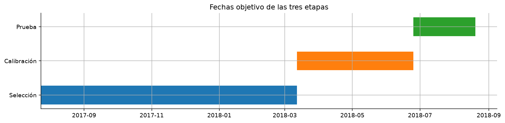
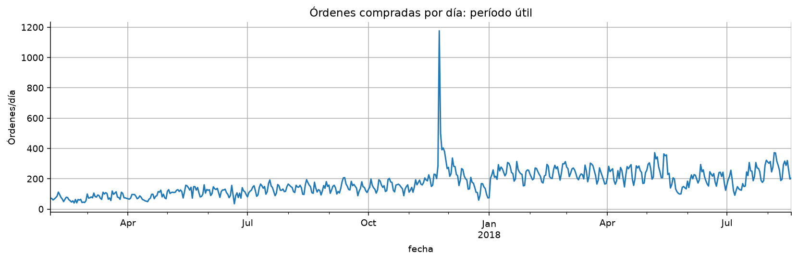
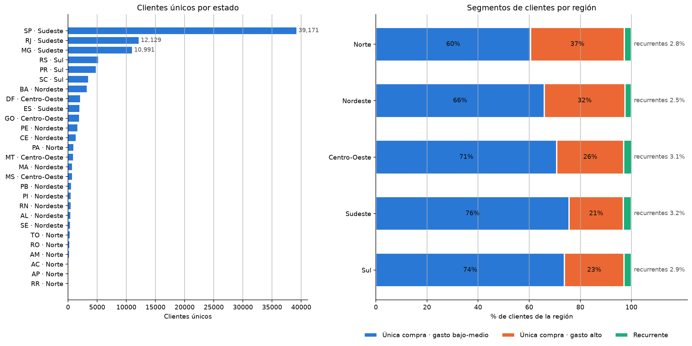
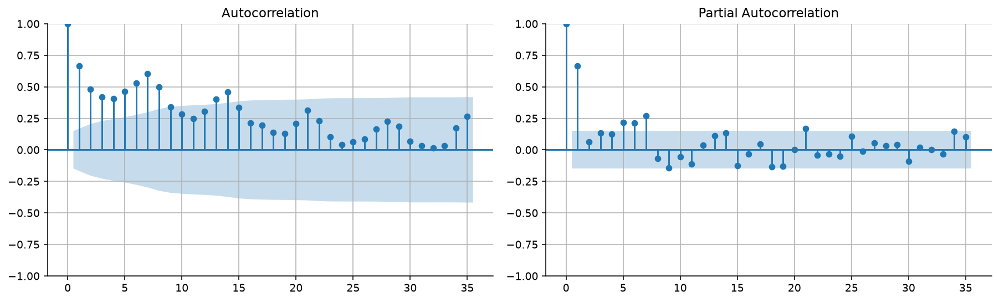
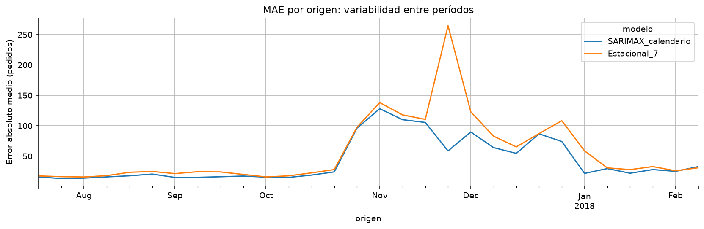
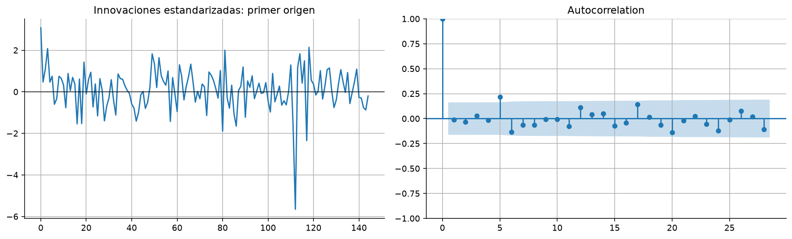
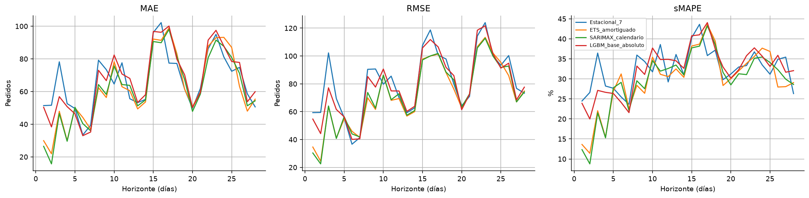
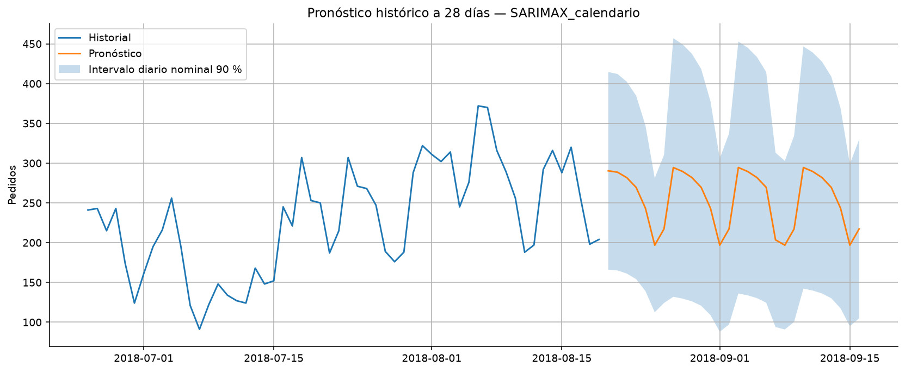

# Pronóstico diario de órdenes de Olist

Módulos 0 y B · horizonte 28 días · evaluación semanal retrospectiva

## 1. Problema y protocolo

Pronosticar órdenes recibidas por día durante los siguientes 28 días, desde el cierre de cada domingo: cada emisión cubre cuatro semanas completas de lunes a domingo. Alcance: Módulo 0 y Módulo B. La unidad es la orden; la fecha es la compra. El conteo incluye todos los estados finales.

Período útil: 2017-02-01 a 2018-08-19. La cobertura continua llega a 2018-08-21; la serie se corta en el último domingo anterior o igual a esa fecha. El corte responde a cobertura y no demuestra una causa específica para la caída de registros al final. Toda la evaluación es retrospectiva: las fechas de prueba ya eran conocidas.

Selección: SARIMAX_calendario, MAE 42.01. Prueba: MAE 61.72, frente a 66.42 de la referencia semanal. La cobertura diaria relativa fue 75.7%, inferior al 90 % nominal.

Los modelos se reajustan en cada emisión. Los objetivos no se cruzan entre etapas; dentro de cada una se solapan las ventanas. No se considera que todos los pares sean independientes.

**Fechas objetivo del protocolo**

| Etapa | Objetivos desde | Objetivos hasta | Emisiones |
| --- | --- | --- | --- |
| Selección | 2017-07-24 | 2018-03-11 | 30 |
| Calibración | 2018-03-12 | 2018-06-24 | 12 |
| Prueba | 2018-06-25 | 2018-08-19 | 5 |

## 2. Datos, calidad y cobertura

Se consulta DuckDB en modo de solo lectura. SQL realiza lecturas, uniones, filtros, agregaciones y ventanas de datos. La serie nace de orders sin multiplicar compras mediante artículos ni pagos.

El calendario diario completo representa ceros si falta actividad dentro del intervalo. Se obtienen 565 días y 97,091 órdenes; la auditoría concilia sus valores. Las fechas extremas se inspeccionan antes de definir el universo del ejercicio.

EDA común: mediana de entrega 10 días, p90 23 y 6.77% tardías en las observaciones elegibles. Los compradores con varias compras son 2,997 de 96,096 identidades únicas. Los atributos finales de entrega no son predictores.

Geografía del cliente (customer_unique_id): El Sudeste reúne 68.4% de los clientes únicos del período útil. La recurrencia va de 2.5 % a 3.2 % según la región, y el segmento de única compra con gasto alto pesa más en Norte (37 %) y Nordeste (32 %) que en Sudeste (21 %).

**Calidad relevante al objetivo**

| Comprobación | Resultado |
| --- | --- |
| Órdenes en la base | 99441 |
| Filas de unión directa ítems y pagos | 118434 |
| Órdenes sin ítems | 775 |
| Órdenes sin pagos | 1 |
| Diferencias monetarias > 2 centavos | 280 |
| Compras sin fecha / IDs duplicados | 0 / 0 |

## 3. Diagnóstico temporal inicial

Se estudian solo 173 días, hasta 2017-07-23. Las medias móviles SQL terminan en la fecha observada. El patrón semanal se resume por medias y medianas; no se interpreta causalmente.

STL robusta con período 7 separa tendencia, semana y residuo para descripción. Sus componentes no se usan como variables porque la descomposición puede utilizar vecinos posteriores dentro del tramo.

ADF y KPSS parten de hipótesis distintas. Nivel: ADF no rechaza raíz unitaria y KPSS rechaza estacionariedad. Diferencia semanal: ADF rechaza raíz unitaria y KPSS no rechaza estacionariedad. Las pruebas orientan; no determinan un único modelo.

**Pruebas de estacionariedad**

| serie | ADF_p | KPSS_limite |
| --- | --- | --- |
| nivel | 0.715181 | <= 0.01 |
| diferencia_1 | 5.46658e-06 | >= 0.10 |
| diferencia_7 | 0.0018408 | >= 0.10 |

## 4. Variables y prevención de fuga

Cada ejemplo representa origen o y horizonte h. La historia termina en o, la fecha objetivo es o+h y su calendario sí es conocido. El objetivo real nunca forma parte de las entradas.

Se exige que la fecha de la etiqueta sea menor o igual al origen del ajuste. Filtrar únicamente el origen de la fila permitiría etiquetas todavía desconocidas. Todas las variantes ML comparten filas con 91 días completos de historial.

El modelo ML es directo global: un único modelo aprende todos los horizontes usando h. No utiliza reales intermedios ni una cadena recursiva de predicciones.

Objetivo relativo: log(1+y)-log(1+media28). Inversión: exp(r)*(1+media28)-1, usando la media del origen y recortando a cero. L1 apunta a una mediana condicional; no equivale automáticamente a estimar la media.

**Características SQL**

| Grupo | Contenido |
| --- | --- |
| Básicas | Rezagos 0, 6, 13, 27; medias 7/28; dispersión 28 |
| Calendario | Horizonte, semana, mes, tendencia y eventos conocidos |
| Ampliadas | Últimos 7 días, media 91, razones y dispersión relativa |
| Día comparable | Último mismo día de semana y media de cuatro |
| Relativas | Rezagos y días comparables respecto a media 28 |

**Ejemplo desde el primer origen**

| h | lag_0 | media_28 | ultimo_mismo_dia | media_4_mismo_dia |
| --- | --- | --- | --- | --- |
| 1 | 105 | 124.75 | 168 | 125.25 |
| 7 | 105 | 124.75 | 105 | 105.25 |
| 28 | 105 | 124.75 | 105 | 105.25 |

## 5. Candidatos y selección

Ingenuo repite el último valor; Estacional_7 repite la última semana. ETS combina nivel, tendencia amortiguada y semana aditiva. SARIMAX usa log1p, errores ARIMA(1,1,1), seis indicadores semanales y calendario. No tiene diferencia semanal adicional.

Las cuatro variantes LightGBM cruzan variables básicas/ampliadas y objetivo absoluto/relativo con idénticos 300 árboles, 7 hojas y pérdida L1. No se presupone que el relativo sea superior.

Se elige SARIMAX_calendario por MAE en 840 pares. Los días difíciles permanecen. Black Friday 2017 tiene 1.176 pedidos y no había un evento anterior para estimar su magnitud; varios de los mayores errores corresponden a esa fecha.

Los avisos de ajuste se registran; ningún ajuste sin convergencia se acepta. En el primer SARIMAX, Ljung–Box p7=0.0527 y p14=0.2261; no demostrar autocorrelación al 5 % no prueba adecuación universal.

**Selección: menor es mejor**

| modelo | MAE | RMSE | sMAPE |
| --- | --- | --- | --- |
| SARIMAX_calendario | 42.01 | 91.51 | 20.32 |
| LGBM_base_absoluto | 48.22 | 99.56 | 22.95 |
| LGBM_amplio_absoluto | 49.98 | 103.13 | 23.50 |
| Estacional_7 | 56.39 | 122.85 | 25.68 |
| LGBM_base_relativo | 57.58 | 116.57 | 25.85 |
| LGBM_amplio_relativo | 58.32 | 118.78 | 25.76 |
| ETS_amortiguado | 60.62 | 137.07 | 24.91 |
| Ingenuo | 64.33 | 109.72 | 34.12 |

**Factores ML: diferencia negativa favorece al candidato**

| comparacion | diferencia_MAE | origenes_mejora |
| --- | --- | --- |
| Variables con objetivo absoluto | 1.76 | 11 |
| Variables con objetivo relativo | 0.74 | 17 |
| Objetivo con variables básicas | 9.36 | 13 |
| Objetivo con variables ampliadas | 8.34 | 13 |

## 6. Variación entre períodos y errores

Las diferencias por origen importan: un promedio puede ocultar episodios malos. Las emisiones solapadas no se tratan como observaciones independientes para declarar significancia estadística.

Con objetivo absoluto, pasar a variables ampliadas aumenta el MAE en 1.76 pedidos (mejora en 11 de 30 orígenes); el objetivo relativo empeora el promedio en esta ejecución. Esa conclusión está limitada a candidatos, configuración y protocolo evaluados.

El calendario informa la fecha de un evento, no su magnitud. Se conserva la huelga y no se proporciona un indicador futuro que simule conocimiento previo. Las comparaciones de eventos son descriptivas.

Ljung–Box y la ACF residual examinan estructura remanente. Un ajuste que converge puede seguir teniendo sesgo o errores predictivos importantes.

## 7. Evaluación retrospectiva

La prueba contiene cinco emisiones, 140 pares por modelo y 56 fechas. Los objetivos centrales se evalúan desde varias anticipaciones. Se exporta también una métrica con igual peso por fecha.

El elegido logra MAE 61.72, una diferencia de 7.08 % frente al estacional. El seleccionado también presenta el menor MAE de prueba; esa coincidencia no se usó para elegirlo.

El sesgo del seleccionado es -37.80 pedidos: subpronóstico promedio. RMSE penaliza picos, sMAPE da una lectura relativa y MAE permanece en pedidos. Los errores por horizonte no tienen por qué crecer de forma monótona.

**Prueba: comparación en idénticos pares**

| modelo | MAE | RMSE | sMAPE |
| --- | --- | --- | --- |
| SARIMAX_calendario | 61.72 | 76.21 | 29.76 |
| ETS_amortiguado | 62.47 | 75.74 | 29.90 |
| Estacional_7 | 66.42 | 84.58 | 32.56 |
| LGBM_base_absoluto | 67.24 | 82.08 | 32.47 |
| LGBM_base_relativo | 68.45 | 85.41 | 33.07 |
| LGBM_amplio_absoluto | 69.64 | 85.18 | 33.66 |
| LGBM_amplio_relativo | 71.68 | 88.65 | 34.99 |
| Ingenuo | 77.61 | 94.06 | 37.69 |

## 8. Intervalos y cobertura

La calibración utiliza 12 emisiones reservadas. Por semana del horizonte hay 84 errores diarios y se toma el rango 77 para 90 %. Para cada total semanal hay 12 errores y el rango es 12. Se usa orden estadístico exacto, sin interpolación.

Relativo: |real-pred|/(1+pred); margen q*(1+pred). Absoluto: |real-pred|; margen q. El relativo es principal por diseño y el absoluto es un análisis paralelo. Los cuantiles permanecen fijos en prueba.

Para totales se suman primero reales y puntos y luego se calibra el error del total. No se suman límites diarios. No hay garantía de cobertura conjunta de todos los días o semanas.

El relativo cubre 75.7% diario y 80.0% semanal: no alcanza el 90 % nominal. La dependencia, poca muestra y reajustes impiden atribuir una garantía conformal exacta. Las amplitudes y coberturas deben leerse juntas.

**Cobertura diaria (%) y amplitud en pedidos**

| metodo_intervalo | cubiertos | n | porcentaje | ancho_medio |
| --- | --- | --- | --- | --- |
| absoluto | 121 | 140 | 86.43 | 211.95 |
| relativo | 106 | 140 | 75.71 | 195.32 |

**Cobertura de totales semanales (%)**

| metodo_intervalo | cubiertos | n | porcentaje | ancho_medio |
| --- | --- | --- | --- | --- |
| absoluto | 17 | 20 | 85.00 | 1,511.46 |
| relativo | 16 | 20 | 80.00 | 1,574.71 |

## 9. Pronóstico histórico final

Se reajusta SARIMAX_calendario hasta el domingo 2018-08-19 y se pronostica del lunes 2018-08-20 al domingo 2018-09-16: cuatro semanas completas. Suma de puntos: 7,126.27 pedidos. No es una proyección actual de Olist.

Los CSV conservan precisión decimal. La suma de puntos no se presenta como media esperada ni mediana garantizada del total. Los reales futuros permanecen desconocidos.

Los intervalos finales son los relativos fijados en el protocolo; su cobertura observada fue insuficiente en prueba. No se presentan como márgenes operativamente validados al 90 %. No se anuncia un intervalo mensual sumando los semanales.

**Totales semanales con intervalos nominales**

| semana | desde | hasta | pred | inferior | superior |
| --- | --- | --- | --- | --- | --- |
| 1 | 2018-08-20 | 2018-08-26 | 1,787.51 | 1,092.16 | 2,482.85 |
| 2 | 2018-08-27 | 2018-09-02 | 1,792.85 | 685.92 | 2,899.77 |
| 3 | 2018-09-03 | 2018-09-09 | 1,753.07 | 520.88 | 2,985.25 |
| 4 | 2018-09-10 | 2018-09-16 | 1,792.85 | 647.62 | 2,938.07 |

## 10. Reproducibilidad, auditoría y límites

Entorno: Python 3.12, dependencias directas fijadas en requirements.txt. La base local se construye con el script del curso. El análisis usa SQL y read_only=True; la base no se incluye en la entrega.

Orden: instalar requisitos; construir data/olist.duckdb; ejecutar scripts/ejecutar.py; scripts/auditar.py; scripts/generar_documentacion.py. Los notebooks ya se entregan ejecutados, con figuras incrustadas y comentarios.

La auditoría completa 13 grupos de controles: serie, particiones, métricas independientes, baselines, variables, cuantiles, cobertura y reproducibilidad final. Los ocho modelos reproducen sus pronósticos al retirar físicamente el futuro en dos orígenes.

Límites: período corto, una sola observación útil de Black Friday, dependencia entre emisiones, elección de cobertura temporal y prueba ya examinada. La diferencia de MAE frente al baseline es pequeña y la cobertura principal no alcanza el nivel nominal.

Material didáctico: documentacion/guia_completa.md desarrolla cada concepto y analiza todas las tablas. La importancia por ganancia de ML explica el ajuste sin atribuir causalidad.

Datos: Brazilian E-Commerce Public Dataset by Olist (Kaggle). Revisar licencia CC BY-NC-SA 4.0 antes de redistribuir datos derivados. Referencias metodológicas: Forecasting: Principles and Practice; documentación de statsmodels, LightGBM y holidays.

**Controles auditados**

| Área | Evidencia |
| --- | --- |
| SQL y datos | Conteos, regularidad, granularidad y ventanas |
| Evaluación | Métricas SQL y referencias reproducidas |
| Fuga | Futuro retirado, 8 modelos, 2 orígenes |
| Intervalos | Cuantiles y totales conciliados |
| Notebooks | Tres ejecutados, sin errores y comentados |
