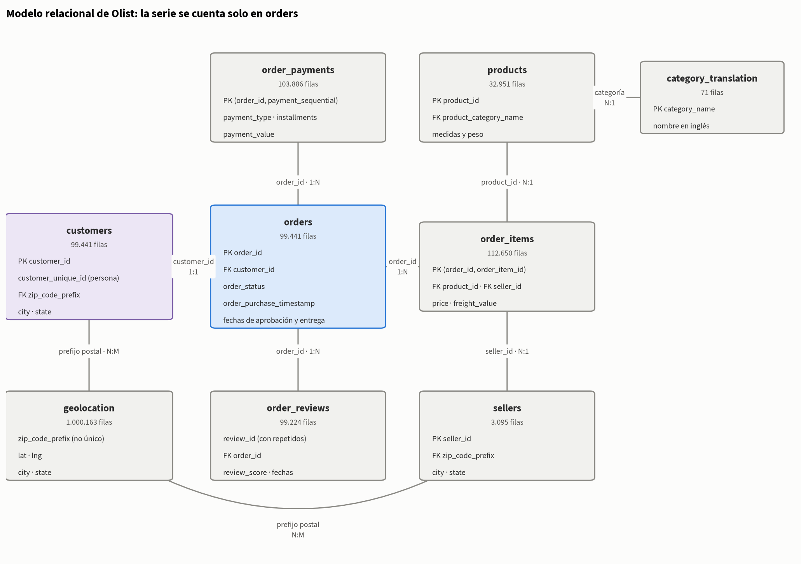
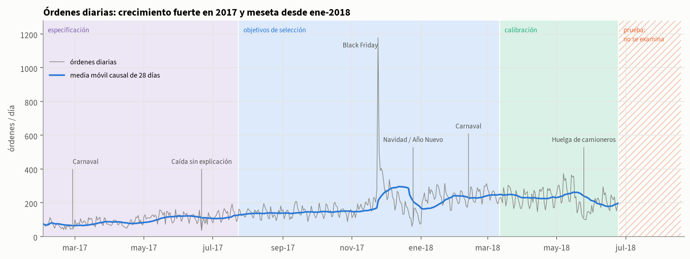
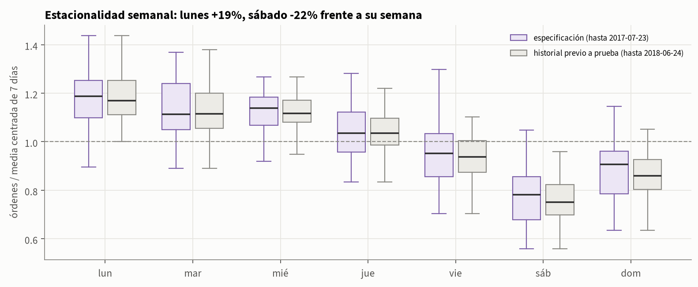
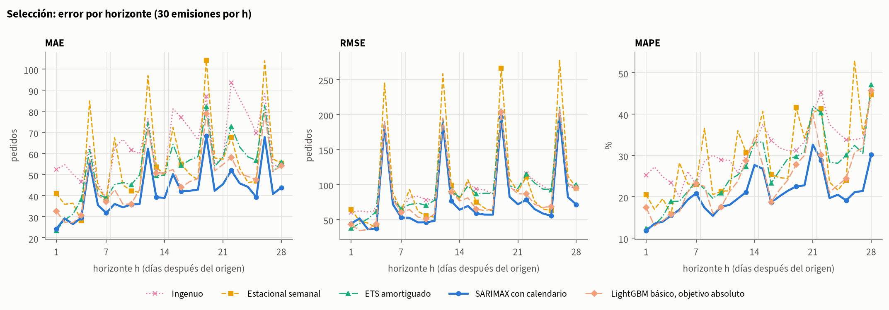
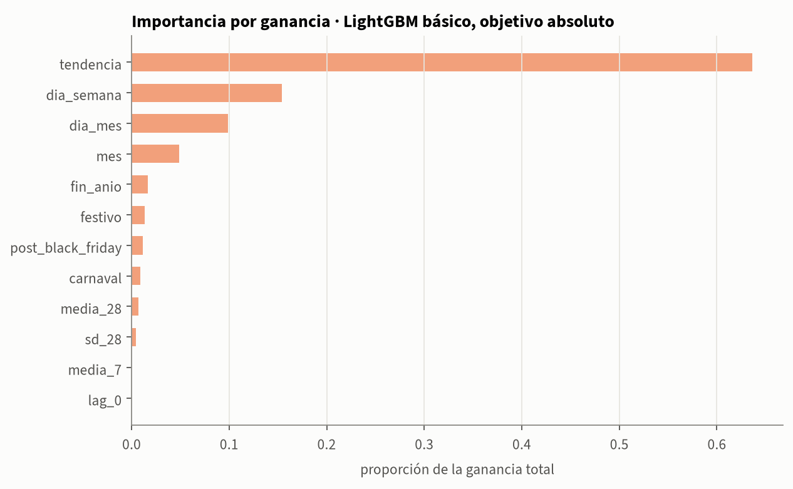
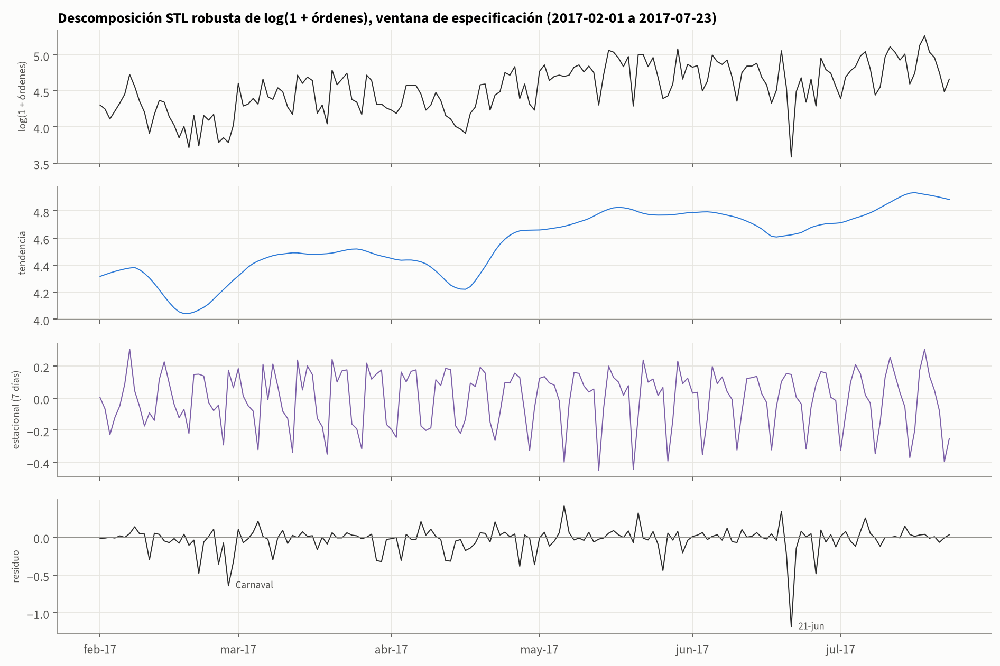
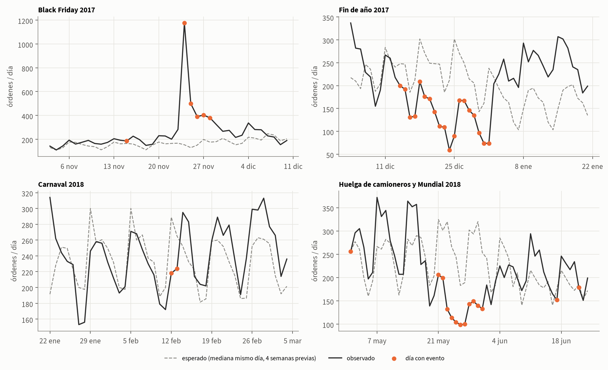

# Pronóstico diario de órdenes de Olist a 28 días

*Formulación, validación con origen móvil e intervalos de predicción para la planeación semanal*

## 1. Resumen ejecutivo

Olist es un *marketplace* brasileño que conecta a pequeños vendedores con los grandes canales de comercio electrónico. Este trabajo resuelve el módulo de series de tiempo del taller, cuya pregunta de negocio es de planeación: ¿cuántas órdenes recibirá la plataforma en las próximas semanas? De esa cifra dependen el personal de atención al cliente, los acuerdos con transportadores y la capacidad que se reserva para los días de mayor carga. La respuesta es un pronóstico diario a 28 días, emitido al cierre de cada domingo a partir de las 97.091 órdenes registradas entre el 1 de febrero de 2017 y el 19 de agosto de 2018.

> **Respuesta: órdenes esperadas del 20 de agosto de 2018 al 16 de septiembre de 2018**

**Tabla 1. Pronóstico semanal y su intervalo del 90 % nominal**

| Semana | Lunes a domingo | Pronóstico (órdenes) | Intervalo del 90 % nominal |
| --- | --- | --- | --- |
| 1 | 20-ago a 26-ago | 1.789 | 1.096 – 2.483 |
| 2 | 27-ago a 2-sep | 1.794 | 669 – 2.918 |
| 3 | 3-sep a 9-sep | 1.754 | 504 – 3.004 |
| 4 | 10-sep a 16-sep | 1.794 | 631 – 2.957 |

*El intervalo semanal se calibró con errores de totales semanales; no es la suma de los intervalos diarios.*

La demanda esperada ronda las 1.783 órdenes por semana, 7.131 en las cuatro semanas. El modelo conserva el ritmo semanal de la serie: los lunes concentran la mayor carga (unas 296 órdenes) y los sábados la menor (unas 196). El viernes 7 de septiembre, festivo nacional, baja a unas 203 órdenes, frente a las 243 de un viernes corriente.

El pronóstico proviene de un modelo SARIMAX con calendario: una regresión con errores ARIMA, ajustada sobre el logaritmo de la demanda, que incorpora el día de la semana y los eventos comerciales previsibles. Se eligió entre nueve candidatos por su error en 30 emisiones de validación, donde redujo el error absoluto medio en un 25 % frente a la línea base más exigente, que repite lo ocurrido la semana anterior. En las ocho semanas finales, reservadas como prueba, conservó la ventaja, aunque más estrecha (7 %): su error medio fue de 35 órdenes diarias en la primera semana del horizonte y de unas 75 en la tercera y la cuarta.

Los intervalos deben leerse con cautela. En la prueba, el intervalo diario del 90 % contuvo el valor real en el 76,4 % de los casos, y el semanal en el 80 %, porque en agosto de 2018 la demanda subió un 34 % respecto de julio sin un antecedente que permitiera anticiparlo. Se recomienda reajustar el modelo cada domingo, dimensionar la capacidad de la semana siguiente con el pronóstico y su límite superior, y tratar las semanas tres y cuatro como orientativas. El ejercicio es retrospectivo: usa datos públicos de 2017 y 2018 y no es una proyección actual de la empresa.

## 2. Datos, modelo relacional y decisiones de calidad

El conjunto de datos público de Olist reúne unas cien mil órdenes anonimizadas con información de clientes, productos, vendedores, pagos, envíos y reseñas. Se cargó en DuckDB con el script del curso, en 9 tablas que suman 1.550.922 filas, y todo el acceso posterior se hizo con consultas SQL de solo lectura guardadas en `sql/`, con las fechas de corte como parámetros.

### 2.1 Unidad de análisis y modelo relacional

La pregunta de negocio se refiere a órdenes recibidas, de modo que la unidad de análisis es la orden de compra y su fecha es el instante en que el cliente la realizó (`order_purchase_timestamp`). Como muestra la Figura 1, la tabla `orders` ocupa el centro del modelo: cada orden tiene un identificador único y se relaciona uno a uno con su cliente, pero uno a muchos con sus artículos, pagos y reseñas. Si se contaran filas después de unir órdenes con artículos y pagos, la misma compra aparecería varias veces: la unión produce 118.434 filas para 99.441 órdenes. Por eso la serie se cuenta directamente en `orders`, antes de cualquier unión.

*Figura 1. Modelo relacional del conjunto de datos de Olist. Cada caja es una tabla, con su número de filas y sus llaves principales (PK) y foráneas (FK); las líneas indican la llave de unión y su cardinalidad. La serie se cuenta solo en `orders` (azul); `customers` (violeta) se usa únicamente en la exploración geográfica.*

### 2.2 Calidad y período útil

La Tabla 2 resume las comprobaciones que afectan a la serie. El criterio fue no descartar una orden por un problema que no invalida ni su existencia ni su fecha de compra: una orden sin artículos registrados o con una diferencia de centavos entre artículos y pagos es un defecto del extracto, no una compra inexistente. Por la misma razón se incluyen todas las órdenes, cualquiera sea su estado final; las 625 canceladas y las 609 indisponibles también representan demanda que llegó a la plataforma.

**Tabla 2. Comprobaciones de calidad relevantes para la serie y decisión adoptada**

| Comprobación | Resultado | Decisión |
| --- | --- | --- |
| Unicidad de order_id | 99.441 órdenes, 0 duplicadas | orders es la unidad de conteo |
| Unión con ítems y pagos (1:N) | 118.434 filas | Se cuenta antes de cualquier unión |
| Fechas de compra | 0 faltantes; 0 entregas previas a la compra | La fecha de compra es confiable |
| Órdenes sin ítems / sin pagos | 775 / 1 | Se conservan: la compra ocurrió |
| Ítems frente a pagos (> 2 centavos) | 280 órdenes | Se informa; no afecta la fecha |
| Aprobación / entrega sin fecha | 160 / 2.965 | Esperable en canceladas o en curso |
| review_id repetido | 814 casos | Las reseñas no intervienen |
| Identidad del comprador | 96.096 personas para 99.441 customer_id | La persona es customer_unique_id |

El extracto no tiene la misma cobertura en todo su rango. En 2016 los registros son escasos y discontinuos, propios de un período de arranque. Hasta mediados de agosto de 2018 se registran entre 200 y 370 órdenes diarias con el patrón semanal habitual, pero a partir del 22 de agosto la cifra cae día tras día hasta casi cero: es el corte del extracto, no un colapso de la demanda. Por eso el período útil va del 1 de febrero de 2017 al 19 de agosto de 2018, el último domingo anterior al corte, de modo que cada pronóstico cubra cuatro semanas completas de lunes a domingo. La serie se construyó en SQL sobre un calendario completo, para que un día sin órdenes apareciera con valor cero en lugar de desaparecer: resultan 565 días consecutivos y 97.091 órdenes, sin días vacíos.

## 3. Módulo B: series de tiempo

### 3.1 Formulación y protocolo de evaluación

Sea $y_t$ el número de órdenes compradas el día $t$. Al cierre de un domingo $o$, llamado *origen*, se dispone de la historia $y_1, \dots, y_o$ y se desea pronosticar $y_{o+h}$ para cada horizonte $h = 1, \dots, 28$; cada conjunto de 28 pronósticos es una *emisión*. El horizonte de cuatro semanas responde al ciclo de planeación, y los orígenes en domingo garantizan que la primera semana pronosticada empiece un lunes. Como el valor de hoy depende del de ayer y del mismo día de la semana anterior, las observaciones no pueden barajarse, y el único error relevante es el de un pronóstico emitido con la información disponible en el origen.

Para reproducir el uso real se empleó una validación con origen móvil (*walk-forward*) y ventana expansiva: en cada origen el modelo se reentrena con toda la historia hasta ese domingo, emite sus 28 pronósticos y el origen avanza una semana. Las emisiones se repartieron en tres etapas sin fechas objetivo en común (Figura 2). La **validación** (30 emisiones, desde el 23 de julio de 2017) sirve solo para elegir el modelo; la **calibración** (12 emisiones, desde el 11 de marzo de 2018) estima los intervalos con errores que no intervinieron en esa elección, y la **prueba** (5 emisiones, desde el 24 de junio de 2018) mide el desempeño una única vez.

*Figura 2. Esquema de validación con origen móvil. Cada fila es una emisión: la línea gris es la historia usada para ajustar, que crece con cada origen, y la barra de color son los 28 días pronosticados (azul: validación; verde: calibración; naranja: prueba). La franja violeta indica los datos usados para decidir la forma de los modelos.*

La forma de los modelos se decidió únicamente con los 173 días anteriores al primer origen de validación; los datos de prueba no se consultaron en ninguna decisión. El costo de esta disciplina es que las primeras emisiones de validación se ajustan con menos de seis meses de datos y nunca han visto un Black Friday.

### 3.2 Análisis de la serie

La Figura 3 muestra la serie hasta el inicio de la prueba. Durante 2017 la media diaria pasó de unas 64 órdenes en febrero a unas 149 en octubre, y desde enero de 2018 se estabilizó en una meseta de entre 222 y 240. Un modelo con tendencia lineal fija extrapolaría un crecimiento que ya no ocurre; por eso ningún modelo estadístico incluye deriva y la tendencia de ETS se amortigua con el horizonte.

*Figura 3. Órdenes diarias (gris) y media móvil causal de 28 días (azul) hasta el primer origen de prueba. Las franjas indican la etapa de cada tramo de fechas; la zona rayada es la prueba, que no se examinó durante el análisis.*

Para aislar la estacionalidad semanal, cada día se dividió por la media de los siete días centrados en él, sin semanas con eventos (Figura 4). El lunes queda un 19 % por encima de su semana y el sábado un −22 % por debajo, con medianas casi idénticas entre la ventana de especificación y toda la historia previa a la prueba, aunque el nivel casi se cuadruplicó. Un patrón estable admite representarse con un indicador fijo por día. Además, el efecto es multiplicativo: la dispersión de cada semana crece con su nivel (correlación de 0,68) y deja de hacerlo tras aplicar $\log(1+y)$ (−0,02). Por eso los modelos estadísticos se ajustan en esa escala; al invertirla, el pronóstico corresponde a la mediana, coherente con evaluar mediante el error absoluto.

*Figura 4. Razón entre las órdenes de cada día y la media de su semana centrada, sin días con evento. En violeta, la ventana de especificación; en gris, toda la historia previa a la prueba. Un valor de 1 corresponde a un día promedio de su semana.*

La descomposición STL robusta de $\log(1+y)$ (Figura 8, Anexo C) confirma una tendencia creciente y un componente semanal de amplitud estable; su residuo solo destaca el lunes de Carnaval de 2017 y el 21 de junio de 2017, un día con 35 órdenes que ningún calendario explica. Para decidir la diferenciación se combinaron dos pruebas con hipótesis nulas opuestas (Tabla 3): la de Dickey-Fuller aumentada (ADF) supone una raíz unitaria y la KPSS, estacionariedad. Ambas coinciden en que el nivel no es estacionario y la primera diferencia sí, de modo que basta $d = 1$; la diferencia semanal también resulta estacionaria, así que las pruebas no eligen entre ambas.

**Tabla 3. Pruebas de estacionariedad sobre $\log(1+y)$ en la ventana de especificación**

| Serie en log(1 + y) | n | p ADF | p KPSS | Conclusión conjunta |
| --- | --- | --- | --- | --- |
| Nivel | 173 | 0,637 | ≤ 0,01 | No estacionaria |
| Primera diferencia (Δ) | 172 | < 0,001 | ≥ 0,10 | Estacionaria |
| Diferencia semanal (Δ₇) | 166 | < 0,001 | ≥ 0,10 | Estacionaria |
| Ambas (Δ y Δ₇) | 165 | < 0,001 | ≥ 0,10 | Estacionaria |

*KPSS solo reporta su valor p entre 0,01 y 0,10; fuera de ese rango se indica el límite.*

La elección la resolvieron la autocorrelación y la comparación de modelos. En las funciones ACF y PACF (Figura 9, Anexo C), la primera diferencia conserva picos cada siete días; al descontar los indicadores de día y de eventos desaparecen y queda una correlación negativa en el primer rezago, propia de una media móvil de orden uno. Con el criterio de Akaike, ARIMA(1,1,1) quedó a 1,7 puntos del mejor orden, una diferencia que suele considerarse equivalente, y al forzar una diferencia estacional su coeficiente de media móvil se situó entre −0,94 y −0,88: un valor cercano a −1 anula esa diferencia e indica que la semana es determinística. Con esta evidencia se fijó, antes de cualquier validación, el modelo principal:

$$ \ln(1+y_t)=\sum_{k=1}^{6}\beta_k\,D_{k,t}+\sum_{j=1}^{5}\gamma_j\,E_{j,t}+u_t,\qquad (1-\phi B)(1-B)\,u_t=(1+\theta B)\,\varepsilon_t \qquad (1) $$

donde $D_{k,t}$ son los indicadores de lunes a sábado (el domingo es la referencia), $E_{j,t}$ los cinco indicadores de eventos, $B$ el operador de rezago y $u_t$ un error ARIMA(1,1,1).

### 3.3 Eventos atípicos

Cada episodio se trató según una regla fijada antes de mirar magnitudes: **modelar** con un indicador si su fecha se conoce antes de emitir el pronóstico, **marcar** si no podía anticiparse (se mide su efecto sin dar al modelo información futura) y **excluir** solo los datos que no representan demanda. La magnitud se midió frente a un valor esperado, la mediana del mismo día de la semana en las cuatro semanas previas (Tabla 4; Figura 10, Anexo C).

**Tabla 4. Magnitud de cada episodio y tratamiento adoptado**

| Episodio | Observado / esperado | ¿Fecha conocida de antemano? | Tratamiento |
| --- | --- | --- | --- |
| Black Friday | × 7,6 | Sí | Modelar |
| Cuatro días posteriores a Black Friday | × 2,6 | Sí | Modelar |
| Fin de año (24-dic a 1-ene) | × 0,51 | Sí | Modelar |
| Festivos nacionales | × 0,75 | Sí | Modelar |
| Carnaval (2018) | × 0,80 | Sí | Modelar |
| Semana previa a Navidad | × 0,66 | Sí | Marcar (solo observada en validación) |
| Huelga de camioneros (11 días) | × 0,51 | No | Marcar (sin indicador futuro) |
| Arranque 2016 y truncamiento final | — | — | Excluir (artefacto de datos) |

*Razón entre lo observado y lo esperado en el conjunto de días del episodio.*

Black Friday fue el mayor (1.176 órdenes frente a unas 154 esperadas) y su efecto se arrastra cuatro días; el fin de año redujo la demanda a la mitad durante toda la semana. Los festivos tienen un efecto medio de × 0,75, muy variable (de × 0,30 a × 1,47). Carnaval, que no es festivo nacional, se incorporó porque su fecha depende de la Pascua y su efecto ya era visible en febrero de 2017. La caída de la semana previa a Navidad (× 0,66) solo se observó en diciembre de 2017, dentro de la validación, y se documentó como limitación para no especificar el modelo con datos de evaluación. La huelga de camioneros de mayo de 2018 se marcó y se conservó en las métricas: no podía anticiparse, pero la operación real también enfrenta choques así.

### 3.4 Variables, fuga de información y estrategia multipaso

El modelo de aprendizaje automático, LightGBM, es un conjunto de árboles potenciados por gradiente que necesita ejemplos supervisados. Cada ejemplo es un par (origen, horizonte): sus entradas describen la historia al cierre del origen y el calendario de la fecha objetivo, y su salida es la demanda de ese día (Tabla 5). Todas las variables se calculan en SQL con ventanas que terminan en el origen.

**Tabla 5. Variables del modelo LightGBM**

| Grupo | Variables (calculadas en SQL con ventanas que terminan en el origen) |
| --- | --- |
| Historia al cierre del origen | Valor del origen y rezagos de 1 a 6, 13 y 27 días; medias de 7, 28 y 91 días; desviación de 28 días |
| Día comparable | Último valor y media de las 4 semanas previas del mismo día de la semana que la fecha objetivo |
| Versiones relativas | Rezagos y día comparable expresados en log respecto a la media de 28 días |
| Calendario de la fecha objetivo | Horizonte h, día de la semana y del mes, mes, índice de tiempo y los cinco indicadores de eventos |

Contra la fuga de información, en cada ajuste solo entran ejemplos cuya **fecha objetivo** sea anterior o igual al origen: un ejemplo emitido ayer a 28 días apunta a una etiqueta todavía desconocida. El calendario futuro sí se conoce; las ventas futuras, no. La auditoría del proyecto lo verifica reconstruyendo la serie sin las compras posteriores a dos orígenes y comprobando que los nueve modelos producen los mismos pronósticos.

Los 28 valores pueden obtenerse de forma **recursiva**, reutilizando cada predicción como dato para la siguiente, o **directa**, aprendiendo cada horizonte desde el origen. Los modelos estadísticos son recursivos: el filtro de Kalman propaga su estado con el calendario futuro conocido. LightGBM usa una estrategia **directa global**, con un único modelo que recibe el horizonte $h$ como variable; así no acumula sus propios errores y comparte entre horizontes lo aprendido sobre la semana y los eventos.

### 3.5 Modelos comparados y métricas

La Tabla 6 resume los nueve candidatos, fijados antes de evaluar. La línea base estacional, que repite el mismo día de la semana anterior, es exigente porque captura el ritmo semanal sin estimar nada. La variante SARIMAX sin eventos no busca ganar, sino medir cuánto aporta modelar los eventos. Las cuatro variantes de LightGBM comparten 300 árboles de siete hojas, pérdida L1 y semilla fija, y cruzan el conjunto de variables con el objetivo: absoluto, o relativo al nivel reciente, definido como el logaritmo de la razón entre la demanda del día objetivo y la media de los 28 días previos al origen.

**Tabla 6. Modelos candidatos y estrategia con que producen los 28 pronósticos**

| Modelo | Estructura | Estrategia multipaso |
| --- | --- | --- |
| Ingenuo | Repite el último valor observado | Regla (línea base) |
| Estacional semanal | Repite el valor del mismo día de la semana anterior | Regla (línea base) |
| ETS amortiguado | Nivel, tendencia amortiguada y semana aditiva sobre log(1 + y) | Recursiva |
| SARIMAX sin eventos | Errores ARIMA(1,1,1) en log(1 + y) y seis indicadores de día | Recursiva |
| SARIMAX con calendario | Lo anterior más cinco indicadores de eventos de calendario | Recursiva |
| LightGBM (cuatro variantes) | Variables básicas o ampliadas × objetivo absoluto o relativo; 300 árboles de 7 hojas, pérdida L1 | Directa global |

*La equivalencia con los identificadores del código figura en el Anexo B.*

Las métricas se calculan sobre los pares origen-horizonte, en órdenes por día:

$$ \mathrm{MAE}=\frac{1}{N}\sum_{i=1}^{N}|y_i-\hat{y}_i|,\qquad \mathrm{RMSE}=\sqrt{\frac{1}{N}\sum_{i=1}^{N}(y_i-\hat{y}_i)^2} \qquad (2) $$

$$ \mathrm{MAPE}=\frac{100}{N}\sum_{i=1}^{N}\frac{|y_i-\hat{y}_i|}{y_i},\qquad \mathrm{sMAPE}=\frac{200}{N}\sum_{i=1}^{N}\frac{|y_i-\hat{y}_i|}{|y_i|+|\hat{y}_i|} \qquad (3) $$

El MAE es el criterio de selección porque responde a la pregunta operativa: por cuántas órdenes se equivoca el plan en un día típico. El RMSE penaliza más los errores grandes; MAPE y sMAPE expresan el error en términos relativos (no hay días con cero órdenes en los períodos evaluados). Se informa también el sesgo, la media de $\hat{y}_i - y_i$. Como las emisiones se solapan, los errores no son independientes y no se presentan pruebas de significancia entre modelos.

### 3.6 Resultados

En validación (Tabla 7), el SARIMAX con calendario obtuvo el menor error: 42,2 órdenes diarias, un 25 % menos que la línea base estacional (56,4) y un 34 % menos que la ingenua, y fue también el más estable entre orígenes (desviación de 35 frente a 55). En todos los modelos el RMSE duplica al MAE por unos pocos errores enormes: Black Friday de 2017 se pronosticó desde cuatro orígenes que nunca habían visto uno y no se eliminó de la evaluación.

**Tabla 7. Desempeño en validación: 30 emisiones × 28 horizontes, ordenado por MAE**

| Modelo | MAE | RMSE | MAPE (%) | sMAPE (%) | Sesgo | Mejora (%) |
| --- | --- | --- | --- | --- | --- | --- |
| SARIMAX con calendario | 42,2 | 91,6 | 20,5 | 20,5 | −18,8 | 25,2 |
| LightGBM básico, objetivo absoluto | 48,2 | 99,6 | 24,3 | 22,9 | −16,8 | 14,5 |
| LightGBM ampliado, objetivo absoluto | 50,0 | 103,1 | 25,5 | 23,5 | −15,2 | 11,4 |
| SARIMAX sin eventos | 51,4 | 102,9 | 25,8 | 24,1 | −13,6 | 8,9 |
| ETS amortiguado | 53,3 | 108,2 | 26,7 | 24,5 | −10,8 | 5,5 |
| Estacional semanal | 56,4 | 122,9 | 29,3 | 25,7 | −9,2 | 0,0 |
| LightGBM básico, objetivo relativo | 57,6 | 116,6 | 30,8 | 25,8 | −2,7 | −2,1 |
| LightGBM ampliado, objetivo relativo | 58,3 | 118,8 | 31,0 | 25,8 | −3,1 | −3,4 |
| Ingenuo | 64,3 | 109,7 | 31,4 | 34,1 | −39,9 | −14,1 |

*MAE, RMSE y sesgo en órdenes por día; MAPE y sMAPE en %. Mejora: reducción porcentual del MAE frente a la línea base estacional. La barra azul señala el modelo elegido.*

Las comparaciones de un solo factor explican parte del resultado. Añadir los indicadores de eventos redujo el MAE del SARIMAX en 9,2 órdenes y lo mejoró en 20 de 30 orígenes. En LightGBM, el objetivo relativo empeoró el error (+9,4 órdenes con variables básicas); una explicación compatible, aunque no aislada por el experimento, es que la media de 28 días deja de representar el nivel futuro cuando este cambia con rapidez. La prueba de Ljung-Box rechazó la ausencia de autocorrelación residual a siete rezagos en 21 de 30 emisiones, de modo que queda estructura semanal sin capturar y el intervalo paramétrico tenderá a ser optimista.

La Figura 5 muestra cómo crece el error con el horizonte. El MAE del modelo elegido pasa de unas 24 órdenes en $h = 1$ a unas 48 entre $h = 22$ y $h = 28$, y su MAPE, de un 12 % a un 23 %; por semana del horizonte, el MAE es de 33 → 40 → 48 → 48 órdenes, siempre entre un 22 % y un 29 % por debajo de la línea base estacional. Los picos en $h$ = 5, 12, 19 y 26 son una sola fecha: Black Friday, vista desde cuatro orígenes.

*Figura 5. Error por horizonte en validación (30 emisiones por cada $h$): MAE y RMSE en órdenes por día, MAPE en %. Cada modelo tiene color, tipo de línea y marcador propios; la línea gruesa azul es el modelo elegido.*

En la prueba, entre el 25 de junio de 2018 y el 19 de agosto de 2018, el modelo elegido ya estaba fijado (Tabla 8). Obtuvo un MAE de 61,5 órdenes, un 7 % mejor que la línea base estacional (66,4). El ETS amortiguado logró un error algo menor (60,8), pero la diferencia, inferior a una orden diaria, es mucho menor que la variación entre emisiones (desviación de 30) y no justifica cambiar de modelo a posteriori. Ningún LightGBM superó a la línea base estacional.

**Tabla 8. Desempeño en prueba: 5 emisiones × 28 horizontes, ordenado por MAE**

| Modelo | MAE | RMSE | MAPE (%) | sMAPE (%) | Sesgo | Mejora (%) |
| --- | --- | --- | --- | --- | --- | --- |
| ETS amortiguado | 60,8 | 75,5 | 27,1 | 29,4 | −37,0 | 8,4 |
| SARIMAX con calendario | 61,5 | 76,0 | 27,4 | 29,7 | −37,2 | 7,4 |
| SARIMAX sin eventos | 62,0 | 76,4 | 27,6 | 29,8 | −37,9 | 6,7 |
| Estacional semanal | 66,4 | 84,6 | 29,8 | 32,6 | −37,0 | 0,0 |
| LightGBM básico, objetivo absoluto | 66,8 | 81,5 | 29,8 | 32,2 | −41,2 | −0,5 |
| LightGBM básico, objetivo relativo | 69,4 | 86,5 | 30,7 | 33,5 | −41,7 | −4,5 |
| LightGBM ampliado, objetivo absoluto | 70,2 | 86,2 | 31,0 | 34,0 | −44,6 | −5,7 |
| LightGBM ampliado, objetivo relativo | 71,5 | 88,5 | 31,4 | 34,9 | −45,3 | −7,7 |
| Ingenuo | 77,6 | 94,1 | 32,3 | 37,7 | −59,6 | −16,8 |

*Mismas unidades que la Tabla 7. El modelo elegido (barra azul) se fijó antes de consultar esta tabla.*

Todos los modelos subpronosticaron en la prueba (sesgo de −37 órdenes diarias para el elegido). La ventaja se concentra en la primera semana del horizonte (35 órdenes frente a 51 de la línea base estacional); en las semanas tres y cuatro, el error de todos los modelos ronda las 75 órdenes. Entre el 6 y el 14 de julio la demanda cayó a entre 90 y 150 órdenes, y en agosto el nivel medio subió de 211 a 283 órdenes diarias: el sesgo del modelo elegido pasó de −4 % en julio a −28 % en agosto. Son errores de nivel, no de forma semanal. Que el valle coincida con la fase eliminatoria del Mundial, o que el salto obedezca a campañas comerciales, son hipótesis que los datos no permiten verificar.

### 3.7 Incertidumbre

Se compararon cuatro intervalos del 90 % nominal, fijados antes de la prueba. El **paramétrico** del SARIMAX se obtiene de la varianza de pronóstico del filtro de Kalman y supone errores normales e independientes. Los tres **conformales** no suponen una distribución: usan los errores de las doce emisiones de calibración. Para cada semana $s$ del horizonte se ordenan los 84 errores relativos $|y-\hat{y}|/(1+\hat{y})$ y se toma el de rango $k$:

$$ \hat{y}_{o+h}\pm\hat{q}_s\,(1+\hat{y}_{o+h}),\qquad \hat{q}_s=e_{s,(k)},\quad k=\lceil (n+1)(1-\alpha)\rceil \qquad (4) $$

Con $n$ = 84 y $\alpha$ = 0,10, el rango es $k$ = 77. El intervalo principal es el conformal relativo del modelo elegido, cuyo ancho crece con el nivel, en coherencia con la serie multiplicativa. Su cuantil fue de 0,42 en la primera semana y de entre 0,51 y 0,55 en las siguientes; sin los días de huelga, que caen en la calibración, el de la primera semana habría bajado a 0,27.

**Tabla 9. Cobertura empírica y amplitud de los intervalos diarios en prueba**

| Intervalo del 90 % nominal | Cobertura | Pares cubiertos | Amplitud media (órdenes) |
| --- | --- | --- | --- |
| Conformal relativo · SARIMAX con calendario (principal) | 76,4 % | 107 de 140 | 197 |
| Paramétrico · SARIMAX con calendario | 73,6 % | 103 de 140 | 188 |
| Conformal absoluto · SARIMAX con calendario | 86,4 % | 121 de 140 | 212 |
| Conformal relativo · LightGBM básico, objetivo absoluto | 70,7 % | 99 de 140 | 184 |

*Cobertura: proporción de valores reales dentro del intervalo; nivel nominal del 90 %. Amplitud en órdenes por día.*

Ningún intervalo alcanzó el 90 %. El conformal principal cubrió el 76,4 % de los días y 16 de 20 totales semanales; el paramétrico, el 73,6 % (ya en la calibración había quedado en el 85,4 %, coherente con la autocorrelación residual). El conformal absoluto llegó al 86,4 % con intervalos más anchos, pero elegirlo ahora sería ajustar el método con la prueba. La cobertura es alta en la primera semana y se degrada con la anticipación, porque los errores de calibración, de marzo a junio, no contenían un valle ni un salto de nivel como los de julio y agosto.

## 4. Interpretabilidad, integración y caso de uso

### 4.1 Qué aprendió el modelo elegido

Los coeficientes del SARIMAX con calendario se leen directamente: como el modelo está en escala logarítmica, $\exp(\beta)-1$ es el efecto porcentual aproximado de cada indicador (Tabla 10). Frente al domingo, el lunes vende un 37 % más y el sábado un 9 % menos; la cifra no contradice el 19 % de la sección 3.2, porque allí la referencia era el promedio de la semana y aquí el domingo, que está por debajo de él. Black Friday multiplica la demanda por 4,4, sus cuatro días posteriores la elevan un 67 %, y el fin de año, un festivo y Carnaval la reducen un 45 %, un 16 % y un 29 %. Son asociaciones históricas, no efectos causales.

**Tabla 10. Coeficientes del SARIMAX con calendario ajustado con toda la historia útil**

| Término | Coeficiente (log) | Efecto aproximado |
| --- | --- | --- |
| Lunes | 0,31 | +37 % |
| Martes | 0,29 | +34 % |
| Miércoles | 0,26 | +30 % |
| Jueves | 0,21 | +24 % |
| Viernes | 0,11 | +12 % |
| Sábado | −0,10 | −9 % |
| Festivo nacional | −0,18 | −16 % |
| Carnaval | −0,34 | −29 % |
| Black Friday | 1,48 | +340 % |
| Cuatro días posteriores a Black Friday | 0,51 | +67 % |
| Fin de año | −0,60 | −45 % |
| AR(1) de los errores | 0,20 | — |
| MA(1) de los errores | −0,64 | — |

*Efecto aproximado = exp(coeficiente) − 1, frente al domingo para los días y frente a un día sin evento para los indicadores.*

La Tabla 11 juzga las decisiones de la sección 3.3 por sus consecuencias. Modelar los eventos redujo el error en los festivos (de 58 a 45 órdenes) y en el fin de año (de 104 a 89); incluso la semana previa a Navidad mejoró (de 122 a 60), porque sin indicadores el pico de Black Friday se absorbe como una subida de nivel. Black Friday no pudo anticiparse en ninguna variante, y Carnaval empeoró (de 33 a 61) porque su coeficiente se estimó con un único antecedente, más intenso que el de 2018.

**Tabla 11. MAE en validación por tipo de día, en órdenes por día**

| Tipo de día | Fechas | Estacional | SARIMAX sin eventos | SARIMAX con calendario | LightGBM básico |
| --- | --- | --- | --- | --- | --- |
| Black Friday | 1 | 1.016 | 1.020 | 1.018 | 1.028 |
| Cuatro días posteriores a Black Friday | 4 | 254 | 240 | 254 | 248 |
| Fin de año (24-dic a 1-ene) | 9 | 113 | 104 | 89 | 93 |
| Semana previa a Navidad (14 a 23-dic) | 10 | 145 | 122 | 60 | 102 |
| Festivo nacional | 6 | 80 | 58 | 45 | 57 |
| Carnaval (lunes y martes) | 2 | 58 | 33 | 61 | 42 |
| Días sin evento | 201 | 40 | 36 | 29 | 34 |

*Fechas: días distintos con esa etiqueta entre los objetivos de validación. Un día con dos etiquetas cuenta en ambas.*

En LightGBM, la importancia por ganancia se concentra en el índice de tiempo (64 %) y el día de la semana (15 %), mientras rezagos y medias móviles casi no intervienen (Figura 6). El modelo aprendió el nivel de cada período a través del índice de tiempo, que un árbol no puede extrapolar: es una explicación plausible, aunque no demostrada, de que no siguiera el salto de agosto.

*Figura 6. Importancia por ganancia del mejor LightGBM de validación (variables básicas y objetivo absoluto), como proporción de la ganancia total.*

### 4.2 Integración y caso de uso

El pronóstico se produce con un flujo que puede ejecutarse cada semana sin intervención manual. Las consultas de `sql/` construyen la serie, el calendario y la tabla de variables; `src/modelos.py` ajusta los candidatos y emite los 28 pronósticos, y `src/evaluacion.py` calcula métricas e intervalos. Los resultados se exportan en un archivo diario y otro semanal, con el pronóstico y sus límites, y cada ejecución termina con una auditoría independiente cuyos 13 grupos de comprobaciones terminaron sin discrepancias.

Al cierre del domingo 19 de agosto de 2018, el equipo de planeación recibe el pronóstico de la semana del 20 de agosto de 2018: 1.789 órdenes, con un intervalo de 1.096 a 2.483. Con el total dimensiona la atención al cliente y los acuerdos con transportadores, usa el límite superior para la capacidad flexible y, con el perfil diario de la Figura 7, distribuye turnos, porque de lunes a miércoles se concentra la carga. Para las semanas tres y cuatro reserva capacidad ajustable. Si el total real de una semana sale del intervalo, o el sesgo de dos semanas seguidas supera el 15 %, el modelo se revisa antes de la siguiente emisión; las campañas comerciales y los choques que el modelo no conoce deben comunicarse al planeador por separado.

*Figura 7. Pronóstico de las cuatro semanas siguientes al último domingo observado. En negro, las últimas ocho semanas de historia; en azul, el pronóstico con su intervalo diario conformal del 90 % (banda); en violeta punteado, el intervalo paramétrico del SARIMAX.*

## 5. Limitaciones, conclusiones y trabajo futuro

### 5.1 Limitaciones

La historia es corta: 565 días, con una sola ocurrencia útil de Black Friday y dos de Carnaval, de modo que las magnitudes de esos eventos son inciertas. La prueba contiene dos cambios de nivel sin antecedente que ningún modelo ni intervalo anticipó. Las emisiones se solapan y los errores están correlacionados, por lo que las diferencias pequeñas entre modelos no son superioridad estadística. La evaluación es retrospectiva, aunque ninguna decisión se tomó con las fechas de prueba, y la base no registra campañas, precios ni inventario, que probablemente explican parte de los cambios de nivel.

### 5.2 Conclusiones

La respuesta a la pregunta de planeación es un pronóstico de unas 1.783 órdenes por semana entre el 20 de agosto de 2018 y el 16 de septiembre de 2018, confiable en su forma semanal y en la primera semana del horizonte, y orientativo para las semanas tres y cuatro. Un modelo estadístico relativamente simple, especificado a partir del diagnóstico de la serie, superó a todas las alternativas en validación y mantuvo la ventaja en la prueba: la escala logarítmica respeta el carácter multiplicativo de la demanda, los indicadores de día capturan una semana estable y los de eventos evitan que los picos contaminen el nivel. LightGBM no aprovechó su flexibilidad con esta historia, lo que no descarta el aprendizaje automático, sino que muestra que con estos datos no añade información que el modelo estadístico no capture. La incertidumbre debe comunicarse con la misma disciplina que el pronóstico puntual: los intervalos son nominales y resultaron optimistas.

### 5.3 Trabajo futuro

- Recalibrar los intervalos cada semana con errores recientes (predicción conformal adaptativa).
- Incorporar variables de campañas comerciales y medios de pago que anticipen saltos de nivel.
- Retirar el índice de tiempo de LightGBM o anclar su objetivo a un nivel más robusto, y reevaluarlo.
- Validar con un segundo diciembre un indicador para la semana previa a Navidad.

## Anexos

## Anexo A. Reproducibilidad

El proyecto se reproduce desde su raíz con cinco órdenes:

- `pip install -r requirements.txt`, con las versiones exactas registradas también en `resultados/entorno.json`;
- `python scripts/build_olist_duckdb.py --out data/olist.duckdb`, el script del curso (el archivo `.duckdb` no se entrega);
- `python scripts/ejecutar.py`, que ejecuta en orden los notebooks `00_datos`, `B_series_01_exploracion` y `B_series_02_modelado`;
- `python scripts/auditar.py`, que verifica los resultados de forma independiente;
- `python scripts/generar_documentacion.py`, que produce este informe a partir de `resultados/`.

LightGBM usa semilla fija (`random_state=2026`) y modo determinista, las rutas son relativas y las consultas SQL reciben sus fechas como parámetros.

## Anexo B. Auditoría y equivalencias

**Tabla 12. Comprobaciones independientes de scripts/auditar.py**

| Comprobación independiente | Estado |
| --- | --- |
| Serie conciliada con compras | OK |
| Protocolo temporal | OK |
| Predicciones y ajustes de selección | OK |
| Predicciones y ajustes de calibración | OK |
| Predicciones y ajustes de prueba | OK |
| Elección reproducible | OK |
| Ventanas y variables históricas | OK |
| Calendario de Black Friday y Carnaval | OK |
| Calendario visible en notebooks | OK |
| Futuro físicamente retirado | OK |
| Intervalos diarios y totales | OK |
| Pronóstico histórico final | OK |
| Notebooks ejecutados y comentados | OK |

**Tabla 13. Equivalencia entre los nombres del texto y los identificadores del código**

| Nombre en el texto | Identificador en el código |
| --- | --- |
| Ingenuo | Ingenuo |
| Estacional semanal | Estacional_7 |
| ETS amortiguado | ETS_amortiguado |
| SARIMAX sin eventos | SARIMAX_solo_semana |
| SARIMAX con calendario | SARIMAX_calendario |
| LightGBM básico, objetivo absoluto | LGBM_base_absoluto |
| LightGBM ampliado, objetivo absoluto | LGBM_amplio_absoluto |
| LightGBM básico, objetivo relativo | LGBM_base_relativo |
| LightGBM ampliado, objetivo relativo | LGBM_amplio_relativo |

## Anexo C. Figuras de diagnóstico

*Figura 8. Descomposición STL robusta de $\log(1+y)$ en la ventana de especificación (febrero a julio de 2017): serie, tendencia, componente semanal y residuo. Se señalan el Carnaval de 2017 y la caída sin explicación del 21 de junio.*

*Figura 9. ACF (izquierda) y PACF (derecha) en la ventana de especificación: nivel de $\log(1+y)$, su primera diferencia y la primera diferencia sin el efecto de los indicadores de día y de eventos. La banda sombreada es el intervalo aproximado del 95 % bajo ausencia de autocorrelación.*

*Figura 10. Observado (línea negra) frente a esperado (línea discontinua: mediana del mismo día en las cuatro semanas previas) alrededor de cuatro episodios. Los puntos naranjas son los días con evento.*

